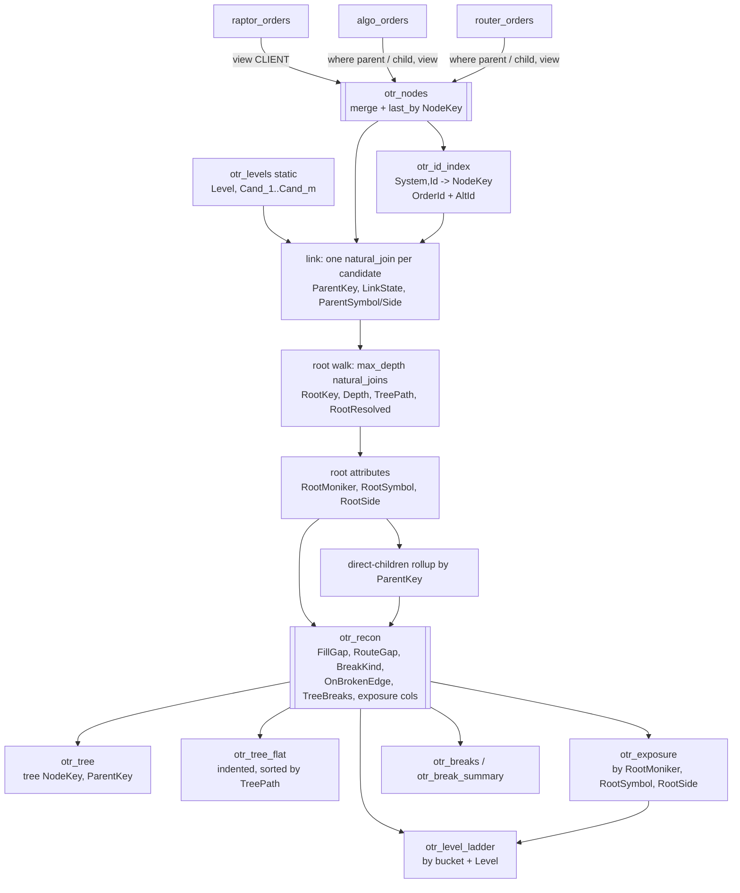

# 14 — Order tree reconciliation: Raptor → algo → order router (contract)

The question this answers:

> Orders flow from the **Raptor** FIX engine to an **algo server** (one parent, many
> children), and each algo child goes to an **order router** (which also has a parent and
> child orders on venues). Every downstream order carries an external order id from its
> upstream system. With all three systems' orders in Deephaven, what is the best way to
> show the **order tree** when I type a **moniker, symbol and side**, and to show the
> **reconciliation of each level's total `CumQty` and `LeavesQty`**, so I know the
> systems' exposure to **bought shares** and **open order shares**?

The submodule [`order-tree-recon/`](../order-tree-recon/) is the runnable answer. It runs
on mock Raptor / algo / router tables in their own native shapes, or on each system's
**FIX order states from AMPS SOW topics** (section 12), and every number in this doc is checked against
the real engine (section 10). It is self-contained and can be exported into another
project with one script (section 13). This doc is **binding** for
that module the way docs 09 and 13 are for theirs: table names, column names and
formulas below are frozen, and a deviation updates this doc in the same change.

---

## 1. The answer in one screen

1. **Normalize, don't join pairwise.** Map each *level* (client order, algo parent,
   algo child, router parent, router child) onto one canonical **node** shape with one
   `view` per level, then `merge` them. Three systems and five levels become one table
   with one parent pointer per row. Pairwise joins (Raptor⋈algo, algo⋈router, …) can't
   handle DMA flow that skips a hop, and get worse with every system you add.
2. **Link through an id index, with ordered candidate systems.** `(System, Id) →
   NodeKey` over every id an order is known by. A level names the systems its parent
   may live in, in order: the router parent tries `ALGO` first, then `RAPTOR`, so DMA
   flow links without special cases.
3. **Find the root with bounded iterated joins.** One `natural_join` per level climbs
   the tree and yields `RootKey`, `Depth` and a depth-first `TreePath` for every node,
   incrementally. Anything deeper than the topology allows is flagged, not mis-rooted.
4. **Copy the root's moniker, symbol and side onto every node.** Only Raptor knows the
   moniker. Filtering on `RootMoniker`/`RootSymbol`/`RootSide` returns **whole trees**,
   all levels, for the moniker you type. Filtering each node on its own columns would
   lose every algo and router order (they carry no moniker) and tear the trees apart.
5. **Reconcile per edge, with signed gaps.** Compare each parent with the sum over its
   *direct* children: `FillGap = CumQty − ΣchildCumQty`,
   `RouteGap = LeavesQty − ΣchildLeavesQty`. The sign carries the meaning. More open
   below than above is over-exposure (red); less is just shares held (amber).
6. **Answer exposure per (moniker, symbol, side) and per level.** Client cum and leaves
   vs street cum and leaves, plus where the difference sits (held, over-routed,
   unbooked, phantom), with two identities that make the numbers add up (section 5.3).
7. **Show it as four panels on one filter:** an exposure table (one row per bucket), a
   level ladder, the native **tree table** (expand/collapse, recon columns on every
   node) and a breaks list. The tree only ships expanded rows to the browser, so the
   whole book needs no paging.

---

## 2. Topology: levels, systems, candidates

| Level | System (id namespace) | Parent may be in | Notes |
|---|---|---|---|
| `CLIENT` | `RAPTOR` | — (root) | the client order; the only level carrying the **moniker** |
| `ALGO_PARENT` | `ALGO` | `RAPTOR` | algo parent, links to Raptor's order id |
| `ALGO_CHILD` | `ALGO` | `ALGO` | algo slice, links to its algo parent (same namespace) |
| `OR_PARENT` | `OR` | `ALGO`, then `RAPTOR` | router parent; algo child id, or Raptor's id for **DMA** |
| `OR_CHILD` | `OR` | `OR` | venue order, **street** level: its open qty is market exposure |

`config.DEFAULT_LEVELS` holds exactly this list, and `config.parse_topology` validates
any other list (unique names, known parent systems, at least one root, a root can't be
the street level). Several levels can share a system: algo parents and children share
the `ALGO` namespace, which is why one `(System, Id)` index serves both the cross-system
hop (router parent → algo child) and the in-system hop (algo child → algo parent).

Tree depth is **data-driven**. A DMA tree is three levels deep and an algo tree five,
and an algo "sub-parent" (an algo child that has its own algo children) adds one more.
The root walk runs `max_depth = len(levels)` passes, which covers one nested algo level.
Anything deeper is `TOO_DEEP` (section 5.2).

## 3. The adapter contract — the only code you rewrite

Each level table handed to the DAG must carry `config.CANONICAL_COLUMNS`:

| Column | Type | Meaning |
|---|---|---|
| `OrderId` | string | this system's id for the order (unique within the system) |
| `AltId` | string | a second id a downstream system may reference (`""` if none) |
| `LinkId` | string | the id this order carries **for its parent**: the external order id for a cross-system hop, the parent order id inside a system, `""` at the root level |
| `Moniker` | string | client moniker; only the root level needs it |
| `Symbol`, `Side` | string | **one side coding across systems** (otherwise every child is a `MISMATCH`) |
| `OrderQty`, `CumQty`, `LeavesQty` | double | int/long are accepted, and nulls become `0.0` |
| `AvgPx` | double | null when nothing has filled |
| `Status`, `Destination` | string | display only (strategy for algo orders, venue for street orders) |

The mock adapters ([`sources.py`](../order-tree-recon/src/order_tree_recon/sources.py))
show every rule on purpose-built native shapes. Raptor uses FIX side codes and has both
`OrderId` and `ClOrdID`. The algo and router tables keep parents and children in one
table, with different column names:

```python
"CLIENT":      raptor.update_view([RAPTOR_SIDE]).view([
                   "OrderId", "AltId = ClOrdID", "LinkId = ``", "Moniker", "Symbol", "Side",
                   "OrderQty", "CumQty", "LeavesQty", "AvgPx", "Status = OrdStatus", "Destination = ``"]),
"ALGO_PARENT": algo.where("ParentAlgoOrderId == ``").view(["LinkId = RaptorOrderId", *algo_common]),
"ALGO_CHILD":  algo.where("!(ParentAlgoOrderId == ``)").view(["LinkId = ParentAlgoOrderId", *algo_common]),
"OR_PARENT":   router.where("ParentRouterOrderId == ``").view(["LinkId = UpstreamOrderId", *router_common]),
"OR_CHILD":    router.where("!(ParentRouterOrderId == ``)").view(["LinkId = ParentRouterOrderId", *router_common]),
```

Rules that matter in a real deployment:

- **Role split.** Use whatever parent/child flag your algo server and router really
  have. If an order matches two role filters, `last_by(NodeKey)` keeps the DAG alive,
  but the order shows up at only one level. A blank parent id must test **null as well
  as `""`** (`isNull(P) || P == ```): a JSON or Kafka feed omits the field, and `P == ```
  alone is false on null, which files the parent as a child with no link (`NO_LINK`) and
  orphans its whole subtree. The mock adapters and their python twin do this.
- **Which id a downstream system stores.** In the mock, the algo server stores Raptor's
  `OrderId` while DMA flow stamps Raptor's outbound `ClOrdID`. Index both (`AltId`), or
  the DMA router parents come out `ORPHAN`. If a cancel/replace rotates the id a
  downstream system stored, pass every id an order was ever known by as `extra_ids`
  (`System, Id, OrderId`) to `build_order_tree`. Current ids win a collision. The FIX
  order-state layer does this for every OrderID / ClOrdID / OrigClOrdID it receives (section 12).
- **The input tables can be anything that is a Deephaven table**: Kafka, a JDBC poll
  (doc 07), parquet, or a remote URI from other servers (doc 10). The DAG is
  incremental, so ticking sources need no code change (section 10, live-fill test).

## 4. The DAG



The steps, as implemented in [`dag.py`](../order-tree-recon/src/order_tree_recon/dag.py):

**4.1 Canonicalize.** One `view` per level (nulls become `""` or `0.0`) stamps `Level`,
`LevelNo`, `System`, `IsStreet` and `NodeKey = System + "|" + OrderId`. Then
`merge(...).last_by("NodeKey")`. The `last_by` is cheap insurance: `natural_join` throws
on duplicate right keys, and one duplicated order must not take the whole DAG down.

**4.2 Id index.**

```python
by_order = nodes.where("OrderId != ``").view(["System", "Id = OrderId", "NodeKey"])
by_alt   = nodes.where("AltId != ``").view(["System", "Id = AltId", "NodeKey"])
otr_id_index = merge([by_order, by_alt]).last_by(["System", "Id"])
```

**4.3 Parent resolution.** `otr_levels` has one `Cand_i` column per candidate position
(`""` when a level has fewer candidates). One `natural_join` per position probes the
index, and the first hit wins:

```python
linked = nodes.natural_join(otr_levels, on=["Level"], joins=["IsRootLevel", "Cand_1", "Cand_2"])
linked = linked.natural_join(otr_id_index, on=["Cand_1=System", "LinkId=Id"], joins=["Hit_1=NodeKey"])
linked = linked.natural_join(otr_id_index, on=["Cand_2=System", "LinkId=Id"], joins=["Hit_2=NodeKey"])
linked = linked.update([
    "ParentKey = !isNull(Hit_1) ? Hit_1 : (!isNull(Hit_2) ? Hit_2 : ((String) null))",
    "LinkState = IsRootLevel ? `ROOT` : (LinkId == `` ? `NO_LINK` : (isNull(ParentKey) ? `ORPHAN` : `LINKED`))",
])
```

The parent's own `Symbol`/`Side` are joined back on `ParentKey` (a diamond, not a cycle)
for the `MISMATCH` check.

**4.4 Root walk.** `Up` is the next ancestor still to visit:

```python
walked = linked.update(["RootKey = NodeKey", "Depth = (int) 0", "TreePath = NodeKey", "Up = ParentKey"])
for _ in range(topology.max_depth):
    walked = walked.natural_join(parent_map, on=["Up=NodeKey"], joins=["NextUp=ParentKey"]).update([
        "TreePath = isNull(Up) ? TreePath : Up + ` > ` + TreePath",
        "RootKey  = isNull(Up) ? RootKey : Up",
        "Depth    = isNull(Up) ? Depth : Depth + 1",
        "Up       = isNull(Up) ? Up : NextUp"]).drop_columns(["NextUp"])
walked = walked.update(["RootResolved = isNull(Up)"])
```

The separator starts with a space, and a space sorts before every printable character,
so a plain `sort("TreePath")` is a **depth-first pre-order walk**: each parent sorts
immediately before its own subtree. That gives the indented flat tree for free.

**4.5 Root attributes.** `walked.view(["RootKey = NodeKey", "RootMoniker = Moniker",
"RootSymbol = Symbol", "RootSide = Side", "RootLevel = Level", "RootOrderId = OrderId",
"RootLinkState = LinkState"])`, natural-joined back on `RootKey`.

**4.6 Direct-children rollup.** `where("!isNull(ParentKey)").agg_by([count_("ChildCount"),
sum_(["ChildOrderQty = OrderQty", "ChildCumQty = CumQty", "ChildLeavesQty = LeavesQty"])],
by=["ParentKey"])`. Only **direct** children count. Comparing a node with its whole
subtree would count the mid levels twice (the rule doc 09 also follows).

**4.7 Recon, second pass, exposure columns.** These are the section 5 formulas. A
second join pulls the parent's "edge broke" flag down to its children (`OnBrokenEdge`),
and a per-`RootKey` sum gives `TreeBreaks`, so "breaks only" can keep whole trees.

Everything is a join or an aggregation. When a fill ticks on one venue order, only that
tree's rows recompute.

## 5. Reconciliation semantics

### 5.1 The two gaps (per node, against its direct children)

| | Non-street node | Street node |
|---|---|---|
| `FillGap` | `CumQty − ΣchildCumQty` (no children: `CumQty`) | `0` |
| `RouteGap` | `LeavesQty − ΣchildLeavesQty` (no children: `LeavesQty`) | `0` |

`HeldQty = max(RouteGap, 0)`, `OverRoutedQty = max(−RouteGap, 0)`,
`UnbookedQty = max(−FillGap, 0)`, `PhantomQty = max(FillGap, 0)`, all per node, then
summed. Positive and negative parts are summed separately, so an over-routed slice and
a held slice never cancel each other out.

### 5.2 The break taxonomy (priority order, first match wins)

| `BreakKind` | Condition | What it means for exposure | Colour |
|---|---|---|---|
| `ORPHAN` | `LinkId` set, resolves to nothing | the order (and everything under it) has no client attached; its street qty is **unattributed exposure** | red |
| `NO_LINK` | non-root level, empty `LinkId` | same, and the upstream system never stamped the id | red |
| `TOO_DEEP` | root not reached in `max_depth` passes (or a data cycle) | would otherwise inherit a blank moniker and vanish from searches | red |
| `MISMATCH` | `Symbol`/`Side` ≠ parent's | a child working the wrong instrument or direction | red |
| `OVERFILL` | `CumQty > OrderQty` | executed beyond the order size | red |
| `UNBOOKED_FILL` | `FillGap < 0` | children executed more than this order shows: **shares bought/sold that upstream has not booked** (missed or late execution report) | red |
| `PHANTOM_FILL` | `FillGap > 0` | this order shows fills its children don't explain (a bust that didn't propagate, an internal cross) | red |
| `CHILD_STILL_OPEN` | `RouteGap < 0` and own `LeavesQty = 0` | parent is done or canceled but a child is still working: **the cancel didn't propagate** | red |
| `OVER_ROUTED` | `RouteGap < 0` | more open below than above: **overfill risk** | red |
| `HELD` | `RouteGap > 0` | open here, not routed further (algo schedule, unrouted client order) | amber |
| `NONE` | edge reconciles | | — |

`UNBOOKED_FILL`, `PHANTOM_FILL`, `CHILD_STILL_OPEN` and `OVER_ROUTED` are **edge**
kinds: they are computed on the parent against its children, and the children get
`OnBrokenEdge = true` so both ends of the discrepancy light up.

**Why the gaps are signed.** Doc 09's taxonomy flags `abs(DeltaLeavesQty) > tol` as
amber `UNROUTED`. That is right for a pure "is the edge clean" view, but an exposure
view must split the two cases: shares sitting in the algo (fine) and more shares on the
street than the client wants (an overfill waiting to happen). Under `abs()` an over-route
is amber. Here it's red `OVER_ROUTED`, or `CHILD_STILL_OPEN` when the parent is already
closed. (Doc 09's blotter is unchanged. If its users care about over-routes, porting
the sign split means one more branch in its `BreakKind` formula plus the taxonomy constants.)

### 5.3 The identities: why the numbers add up

For a tree whose every node is linked (street nodes have no children), summing the
per-node gaps over the tree telescopes. Every non-root node's leaves appear once as a
child term and once as its own term:

```
ClientLeavesQty = Σ RouteGap + StreetLeavesQty = HeldQty − OverRoutedQty + StreetLeavesQty
ClientCumQty    = Σ FillGap  + StreetCumQty    ⇒  StreetCumQty − ClientCumQty = UnbookedQty − PhantomQty
```

So, per (moniker, symbol, side):

- **open order shares**: the client wants `ClientLeavesQty`. `StreetLeavesQty` of it is
  live on venues, `HeldQty` sits in Raptor/algo/router, and `OverRoutedQty` is working
  on the street *beyond* what the client has open;
- **bought (or sold) shares**: the street executed `StreetCumQty` and the client was
  booked `ClientCumQty`. The difference, `NetUnbookedQty`, is the firm's own position
  until booked, and `UnbookedQty`/`PhantomQty` say which edges created it.

Both identities are unit-tested on every complete bucket, and the embedded test asserts
the engine produces the same numbers (section 10). A bucket with an orphan doesn't
satisfy them by construction (the orphan's client is unknown), which is exactly why
unlinked trees are counted (`UnlinkedTrees`) and shown.

## 6. The exposure tables

**`otr_exposure`**: one row per `(RootMoniker, RootSymbol, RootSide)`:

| Column | Answers |
|---|---|
| `ClientOrderQty`, `ClientCumQty`, `ClientLeavesQty` | what the client asked for, was booked, still has open (Raptor, root orders only) |
| `StreetCumQty`, `StreetLeavesQty` | executed on venues, live on venues (`OR_CHILD`) |
| `NetUnbookedQty` | `StreetCumQty − ClientCumQty` — **bought/sold shares not on the client order** |
| `StreetOpenVsClient` | `StreetLeavesQty − ClientLeavesQty` — negative while shares are held upstream; **positive = more working on the street than the client wants** |
| `HeldQty`, `OverRoutedQty`, `UnbookedQty`, `PhantomQty` | where the differences sit |
| `Breaks`, `Trees`, `UnlinkedTrees`, `Orders` | red nodes, root count, roots that are not client orders |

**`otr_level_ladder`**: one row per bucket and level, with `Orders`, `OrderQty`,
`CumQty`, `LeavesQty`, `ExecNotional`, the four gap sums, `Breaks`, and
`CumVsClient`/`LeavesVsClient` (each level's total minus the bucket's client total).
This is the literal "each level's total" view. Read it with one caveat: level totals
only match the client when **all** flow passes through that level. DMA flow skips the
algo levels, so `ALGO_*` legitimately sums less. The per-edge gap columns are the
attribution that stays correct with DMA. The totals are the at-a-glance picture.

Example (scenario `unbooked_fill`, CEDAR / JPM / BUY):

```
Level        Orders OrderQty CumQty LeavesQty HeldQty UnbookedQty Breaks CumVsClient LeavesVsClient
CLIENT            1      900    800       100       0           0      0           0              0
ALGO_PARENT       1      900    800       100       0           0      0           0              0
ALGO_CHILD        3      900    800       100       0           0      0           0              0
OR_PARENT         3      900    800       100     100         100      1           0              0
OR_CHILD          3      900    900         0       0           0      0         100           -100
```

The street executed 900 and everything above it says 800: the router parent lost the
last fill report. The firm is long 100 shares the client doesn't have, and the client
order still shows 100 open that isn't open anywhere.

`Table.rollup` was rejected for the ladder. Its parent rows sum across children, so the
`Side` node of a `Moniker > Symbol > Side > Level` rollup would add the same shares
once per level (five times over). Ladder and exposure are flat aggregations instead.

## 7. The UI (`order_tree_dashboard`)

```
┌──────────────────────────────────────────────────────────────────────────────────┐
│ Moniker [du___v] Symbol [____v] Side [any v] Any order id [______] [x]unlinked [ ]breaks │
├────────────────────────────────────────┬─────────────────────────────────────────┤
│ Exposure by moniker / symbol / side    │ Level ladder                            │
│ (press a row to pin the bucket)        │                                         │
├────────────────────────────────────────┼─────────────────────────────────────────┤
│ Order tree — native, expand/collapse   │ Breaks in view                          │
│ ▾ CLIENT       RPT-00007  NONE         │ CHILD_STILL_OPEN OR_PARENT OR-00013 …   │
│   ▾ ALGO_PARENT ALG-00005 NONE         │                                         │
│     ▾ ALGO_CHILD …-01     NONE         │                                         │
│       ▾ OR_PARENT OR-00013 CHILD_STILL_OPEN  RouteGap −100                       │
│           OR_CHILD OR-00013.1 CANCELED                                           │
│           OR_CHILD OR-00013.2 PARTIALLY_FILLED  LeavesQty 100                    │
└────────────────────────────────────────┴─────────────────────────────────────────┘
```

- **One filter, four tables.** Moniker and symbol are type-in combo boxes fed by
  `otr_moniker_list`/`otr_symbol_list` with a case-insensitive **prefix** match, so
  typing `du` already shows DUNE. Side is a picker. All three match the **root's**
  attributes. Pressing an exposure row pins its bucket **exactly** (typing returns to
  prefix matching): under a prefix match a pinned symbol `C` would also show `CAT`,
  `CSCO` and every other symbol starting with C.
- **include unlinked** (default on) adds trees whose root isn't a client order (orphans)
  to a moniker search, as long as they match the symbol and side. An orphan router order
  can't inherit a moniker, and it is exactly the order a moniker search must not hide.
- **breaks only** keeps whole trees that contain a red node (`TreeBreaks > 0`), never
  isolated nodes.
- **Any order id** resolves an id from *any* system through `otr_id_index` and shows that
  whole tree, narrowing every panel to its bucket. You can start from a venue order id
  and see the client order.
- **Native tree table** (`Table.tree(NodeKey, ParentKey, promote_orphans=True)`) with
  `BreakKind`, the quantities and both gaps right after the order id. Formatting is
  applied before `.tree()` and survives it. `promote_orphans` matters: without it an
  orphan's venue subtree would vanish.
- **No hand-rolled paging.** Deephaven grids are viewport-virtualized, and a tree table
  only ships the rows of expanded nodes, so the whole book costs the browser one row
  per root. (Doc 09 hard-pages because its TODO asked for it. A tree doesn't need it.)
- `otr_tree_flat` is the same trees as a normal table: sorted by `TreePath`, with a
  `Tree` column indented by `Depth`. It pages, filters and row-presses like any table,
  and it is what `order_tree(...)["flat"]` and `find_tree(...)` return.

**A `deephaven.ui` lesson, found in the browser.** A combo box with a *controlled*
`input_value` round-trips every keystroke through the server, and a fast second
keystroke gets overwritten by the stale render (`du` showed up as `u`). The inputs are
therefore uncontrolled (`default_input_value` / `default_value`) with a `key` that is
bumped when a row press or *Clear* needs to set their text, which remounts them.

## 8. Query API (globals)

| Function | Returns |
|---|---|
| `order_tree(moniker=None, symbol=None, side=None, include_unlinked=True)` | `{"tree", "flat", "ladder", "exposure", "breaks"}`: exact match on each given value |
| `find_tree(any_id)` | the whole tree(s) containing an id from any system, as `otr_tree_flat` rows |
| `exposure(moniker=None, symbol=None, side=None)` | `otr_exposure` rows (with a moniker, unlinked buckets are not added) |

All values go through `sanitize_id` (doc 09's rules) before reaching a query string.

## 9. Configuration and deployment

| Variable | Default | Meaning |
|---|---|---|
| `OTR_QTY_TOL` | `1e-6` | absolute tolerance for every quantity comparison |
| `OTR_SEED` | `42` | mock data seed |
| `OTR_MOCK_FAMILIES` | `24` | random healthy families on top of the scenario catalog |
| `OTR_SOURCE` | `mock` | `mock`, `amps` (FIX order states from AMPS SOW topics) or `fix-files` (the same from files) — section 12 |
| `OTR_FIX_DIR` | `/otr-fix` | the mapping and, for `fix-files`, the message files; compose mounts `OTR_FIX_HOST_DIR` (default `order-tree-recon/fix-samples`) there |
| `OTR_FIX_CONFIG` | `<OTR_FIX_DIR>/fix_config.json` | the tag mapping; the built-in `fixstate.DEFAULT_FIX_CONFIG` if that file does not exist |
| `OTR_AMPS_URI` | — | `amps` only: the AMPS URI(s), comma separated for an HA pair, e.g. `tcp://amps-host:9007/amps/fix` |
| `OTR_AMPS_CLIENT_NAME` | `dh-order-tree` | the client name AMPS sees (unique per server: a duplicate logon displaces the other) |
| `OTR_AMPS_BATCH_SIZE` / `OTR_AMPS_TIMEOUT_MS` / `OTR_AMPS_MAX_PENDING` | `1000` / `10000` / `250000` | SOW batch size, command timeout, events buffered between two update cycles |
| `OTR_AMPS_HEARTBEAT` | `5` | seconds between AMPS heartbeats (`0` = off). Without them a half-open connection stalls the feed silently; with them it drops within a couple of intervals and the reconnect snapshot repairs the book (section 12.7) |

A malformed value is a startup error. The topology is code (`config.DEFAULT_LEVELS`),
not an environment variable, because it is coupled to the adapters.

- App folder `docker/apps/order-tree-recon/` (`.app` id `fix42.order.tree.recon`,
  `main.py` → shared loader → `/otr-scripts/order_tree_recon/app.py`).
- `docker/docker-compose.order-tree.yml`: one Deephaven service on the stock
  `ghcr.io/deephaven/server:42.4` image, no broker. `order-tree-recon/scripts/run_demo.sh
  [up|down|status|logs]` wraps it.
- Gradle: `include(":order-tree-recon")`. The module wraps its pytest suite like
  `:basket-oms-demo` (`base` plugin, `pytest` Exec task wired into `check`).

## 10. Verification

- **Reference oracle.** [`reference.py`](../order-tree-recon/src/order_tree_recon/reference.py)
  computes every `otr_recon` column, the ladder and the exposure table with dicts and
  loops. 138 host tests pin it down: every scenario's expected breaks, the edge taxonomy
  case by case, signed gaps, DMA via `AltId`, candidate order, nested algo, `TOO_DEEP`
  and cycles, depth-first `TreePath`, both identities on every complete bucket, the
  filter builders and the mock book's invariants. For the FIX order-state layer:
  - the parser (AMPS bodies, framed messages, log prefixes) and tag-mapping validation;
  - the SOW mirror (latest per key, `oof`, a reconnect snapshot dropping records deleted
    meanwhile) and the fold (sequence / arrival ordering, AvgPx, id history);
  - the mock book as FIX order states, which reconciles exactly like the table path
    (every column but `AltId`, the latest ClOrdID by design);
  - `fixstate_check` on files and on a stubbed AMPS `sow` query;
  - the AMPS source's settings, message classification and subscribe calls.
- **Embedded engine** (`OTR_DH_TEST=1`, `deephaven-server==42.4`). The DAG matches the
  reference **row for row**: 340 nodes × 54 columns, 132 ladder rows, 29 exposure rows,
  zero differences. Also covered: tree, query API and app entrypoint. A **live-fill**
  test makes the router table a keyed input table and adds one venue fill the router
  parent never booked. The parent turns `UNBOOKED_FILL` and the bucket's
  `NetUnbookedQty` becomes 100 incrementally, with no rebuild. For the FIX order-state
  path:
  - the engine's SOW mirror and fold equal the python twins, deletes and a reconnect
    snapshot included, with garbage and malformed values mixed in;
  - the tree equals the reference on every `otr_recon` column;
  - the AMPS source, fed real `AMPS.Message` objects (amps-python-client 5.3.5) through a
    stub client and the real `TablePublisher`, ticks the tree live: snapshot, a fill, an
    `oof`, a reconnect snapshot;
  - `OTR_SOURCE=fix-files` builds the app from `fix-samples/`, and `OTR_SOURCE=amps`
    comes up with empty tables while AMPS is unreachable.

- **A real AMPS broker** (section 12.7): `order-tree-recon/e2e/run_e2e.sh` runs the
  overlay's `broker` profile on a local AMPS 5.3.5 image, publishes FIX order states and
  checks the engine against the python twin after every step, through Deephaven and AMPS
  restarts and a connection dropped by heartbeat. Its first run found that
  `amps-config.xml` did not load at all (a `--` inside an XML comment).
- **Browser.** The app was loaded through the same loader path Application Mode uses
  and driven in headless Chromium: typing a prefix, pinning a bucket by row press,
  expanding a tree to the venue level, searching by a venue order id. The
  controlled-input bug in section 7 was found and fixed this way.

The scenario catalog ([`mockdata.py`](../order-tree-recon/src/order_tree_recon/mockdata.py)):

| Scenario | Bucket | Expected |
|---|---|---|
| `clean_filled` | ACME AAPL BUY | all `NONE` |
| `working` | ACME MSFT BUY | `HELD` on the algo parent (1 200 not yet released) |
| `dma` | BLUEFIN NVDA SELL | Raptor → router directly via `ClOrdID`, all `NONE` |
| `unrouted_client` | BLUEFIN AMZN BUY | `HELD` on the client order |
| `unbooked_fill` | CEDAR JPM BUY | `UNBOOKED_FILL` on one router parent, `NetUnbookedQty = 100` |
| `over_routed` | CEDAR AAPL SELL | `OVER_ROUTED`: two venue orders of 200 under a 300 router parent |
| `cancel_not_propagated` | DUNE MSFT BUY | `CHILD_STILL_OPEN`: everything canceled but one venue order with 100 open |
| `orphan` | (none) NVDA BUY | `ORPHAN` router parent: an unattributed bucket with 200 live on the street |
| `side_mismatch` | ACME NVDA BUY | `MISMATCH` on a SELL venue order under a BUY parent |
| `overfill` | BLUEFIN JPM SELL | `OVERFILL` on the router parent and `UNBOOKED_FILL` on the algo child that capped at its size |
| `nested_algo` | CEDAR NVDA BUY | an algo sub-parent, depth 5, all `NONE` |

## 11. Production notes

- **Transient gaps.** Fills propagate up the chain in milliseconds to seconds, so a
  live book shows short-lived `UNBOOKED_FILL`s. If that is noise, carry each system's
  last-update time through the adapters and flag a gap only once it is older than N
  seconds (`update_view` with `now()`, or a time-based `where` on a ticking clock).
  The structure doesn't change.
- **Internal fills.** An algo cross or a facilitation fill at a non-street level is a
  `PHANTOM_FILL` by construction (the fills don't come from the street). Model the
  internal book as its own street level (one more topology entry and adapter), or
  whitelist it.
- **Scale.** The DAG is a few `natural_join`s per level plus three aggregations. Memory
  is roughly the node table plus a handful of columns per node. For hundreds of millions
  of orders across servers, doc 10's split applies: leaves hold their systems' node
  tables, and a collector runs this DAG over the subscribed union.
- **Id collisions across namespaces** are harmless (the index is per system). Within one
  system, an `AltId` that equals another order's `OrderId` resolves to the `AltId` owner,
  so keep id schemes distinct.
- **Relationship to doc 09.** Doc 09 starts from FIX drop-copy tapes and folds them
  through a state machine. This module starts *after* that, from order states: tables
  (section 3) or each system's latest FIX order state from AMPS (section 12). A doc 09 deployment can feed it by mapping
  `oms_orders_latest` per hub through adapters (`LinkId = ExtOrdID`).

## 12. FIX order states from AMPS SOW topics

Each system publishes its orders' **latest state as FIX messages** into one or more AMPS
SOW topics: Raptor into its topics, the algo server into its own, the router into its own.
Deephaven subscribes to every topic and keeps the order tree, the recon and the dashboard
current as states change. Nothing after section 3 changes. The FIX layer produces the
five level tables.

```
AMPS SOW topics (per system: 1..n)        order_tree_recon.amps_sow
  SOW/RAPTOR/ORDERS ─────────┐            sow_and_subscribe (oof, send_keys) per topic
  SOW/ALGO/ORDERS ───────────┤──────────► one blink event table per system:
   (parents + children)      │            Topic, SowKey, Action, Epoch, Arrival, RawFix
  SOW/OR/ORDERS ─────────────┘
   (parents + venue orders)
                                          order_tree_recon.fixstate_dag
   events ── pick tags (python UDF) ──► T<tag> columns
     ├─ SOW mirror: latest per (Topic, SowKey) · oof removes · stale epochs drop
     │    └─ latest state per order ─► levels + canonical columns (section 3 contract) ──┐
     └─ id history: every 37 / 11 / 41 of every message ─────────────────────────────────┴─► dag.build_order_tree
```

### 12.1 From AMPS messages to orders

| AMPS message | Event | Effect |
|---|---|---|
| `group_begin` | (the topic's `Epoch` += 1) | a new snapshot starts |
| `sow`, `publish` | `UPSERT` | the record's new state replaces the old one |
| `oof`, `sow_delete` | `DELETE` | the record left the SOW (deleted, expired, filtered out): the order leaves the tree |
| `group_end` | `SNAPSHOT_END` | the snapshot is complete |

- **The SOW mirror** keeps the latest event per `(Topic, SowKey)`. The key falls back to
  the order id tag when a message has no SowKey; `send_keys` makes AMPS send one with
  every publish. Aggregations keep their state on a blink table, so memory is one row per
  live record and one per id, not one per message.
- **Reconnects.** The HA client reconnects and re-issues every `sow_and_subscribe`. The
  new snapshot (a new epoch) re-sends every live record, and at its `group_end` the mirror
  drops whatever was not re-sent. Those are records deleted while disconnected, for which
  no `oof` could arrive; without this they would linger as phantom open orders and
  overstate the street exposure. Until `group_end`, the old records stay, so the tree
  never blinks empty.
- **Several topics per system** merge into one table. An order normally lives in one
  topic. If one order can appear in two topics of the same system, set `sequence_tag`
  (e.g. `60` TransactTime, or a version tag) so the latest state wins by content. Without
  it the latest arrival wins.
- **Latest state per order**, then the mapping: the level from the `when` rules, the
  parent link from `link_tag`, and quantities, side and status from the tags.
  - Side and OrdStatus codes are decoded (`"fix"` code tables).
  - A malformed number reads as null, never as an error.
  - AvgPx is null until CumQty > 0, because FIX reports `6=0` on an unfilled order.
- **The id history.** Every OrderID / ClOrdID / OrigClOrdID an order carried in any message
  stays an id of that order. After a cancel/replace, a downstream order that still names
  the original ClOrdID links: through 41 on the latest state, or through the history after
  a second amend. The samples do this; without either, that router parent is `ORPHAN`.
- **Parsing** takes what AMPS delivers: a `fix` topic sends SOH-delimited **bodies without
  the `8=` / `9=` / `10=` framing**. Framed messages, `|` / `^A` delimiters and log
  prefixes are accepted too. The first occurrence of a tag wins.
- **Startup.** The connection runs in a background thread and retries every 5 s, so the
  server and the dashboard come up even while AMPS is unreachable. The tables fill as each
  snapshot arrives; `amps_source.status()` in the console shows each topic's epoch,
  record counts and snapshots completed.

### 12.2 The mapping config

Standard FIX tags are the defaults, so a system usually lists only its topics, its levels
and how parent links are carried. This is `fixstate.DEFAULT_FIX_CONFIG`, also
`fix-samples/fix_config.json`:

```json
{"systems": [
  {"system": "RAPTOR", "topics": ["SOW/RAPTOR/ORDERS"], "files": ["SOW.RAPTOR.*.fix"],
   "levels": [
     {"level": "CLIENT"}
  ]},
  {"system": "ALGO", "topics": ["SOW/ALGO/ORDERS"], "files": ["SOW.ALGO.*.fix"], "tags": {"Destination": "847"},
   "levels": [
     {"level": "ALGO_CHILD", "when": {"tag": "26009"}, "link_tag": "26009"},
     {"level": "ALGO_PARENT", "link_tag": "11"}
  ]},
  {"system": "OR", "topics": ["SOW/OR/ORDERS"], "files": ["SOW.OR.*.fix"],
   "levels": [
     {"level": "OR_CHILD", "when": {"tag": "26009"}, "link_tag": "26009"},
     {"level": "OR_PARENT", "link_tag": "11"}
  ]}
]}
```

How to read it:

- **Cross-system links.** The parent link is the downstream order's own ClOrdID (11):
  the id the upstream sent it with, which the upstream reports as its OrderID (37) or one
  of its ClOrdIDs (11 / 41).
- **In-system links.** An in-system child names its parent's OrderID in tag 26009; a
  parent leaves 26009 null. That also tells parents from children in a shared topic:
  `SOW/ALGO/ORDERS` holds algo parents and their slices, `SOW/OR/ORDERS` router parents and
  their venue orders. The first level's `when` (a non-empty 26009) picks the children and
  the default level the parents, and an absent tag and an empty `26009=` both read as null.
- **Files.** A file name can't hold the `/` of a topic, so the file source labels events
  with the file name minus `.fix` (`SOW.ALGO.ORDERS.fix` -> `SOW.ALGO.ORDERS`), and the
  samples are named that way.
- **Levels.** Each level is chosen by its `when`. The first match wins, and a level
  without `when` is the system's default.

| Key (per system) | Default | Meaning |
|---|---|---|
| `system` | required | a topology system: `RAPTOR`, `ALGO`, `OR` |
| `topics` | `[]` | its AMPS SOW topics (`amps`); a topic belongs to one system |
| `filter` | none | an AMPS content filter applied to every topic of the system, e.g. `/39 NOT IN ('8')` |
| `files` | `[]` | globs under `OTR_FIX_DIR` (`fix-files`); the topic is the file name without extension |
| `order_id_tag` | `"37"` | the stable per-order key |
| `alt_id_tag` | `"11"` | fills `AltId` (latest ClOrdID); `null` for none |
| `id_tags` | `["37", "11", "41"]` | every tag whose values, in any message, identify the order |
| `tags` | `DEFAULT_TAGS` | canonical column → tag, over `Moniker 1`, `Symbol 55`, `Side 54`, `OrderQty 38`, `CumQty 14`, `LeavesQty 151`, `AvgPx 6`, `Status 39`, `Destination 100`; `null` unmaps |
| `side_codes`, `status_codes` | `"fix"` | `"fix"`, `{"code": "NAME"}`, or `null` (values as sent) |
| `sequence_tag` | none (arrival order) | orders one order's states, numerically if numeric, else as text |
| `levels` | required | `[{"level", "when"?: {"tag", "equals"?}, "link_tag"?}]`: every topology level exactly once; root levels have no `link_tag` |

A router that marks its children with a role tag and keeps the parent in 9101 writes:

```json
   "levels": [
     {"level": "OR_CHILD", "when": {"tag": "9100", "equals": "CHILD"}, "link_tag": "9101"},
     {"level": "OR_PARENT", "link_tag": "11"}
  ]
```

`fixstate.parse_fix_config` validates everything at startup and names the system, level
and key at fault. A typo is an error, never a silently empty level. In the Deephaven
tables a tag's value appears as column `T<tag>`, so the SOW mirrors (`fix_<system>_sow`)
show `T37`, `T11`, `T14`, ...

### 12.3 Pointing it at your AMPS

1. **Write `fix_config.json`**: your topics per system, then your tags. Starting from
   `order-tree-recon/fix-samples/fix_config.json`, usually only `topics`, the `when` rules
   and the `link_tag`s change.
2. **Dry-run it against your AMPS.** It runs a one-off `sow` query per topic; nothing is
   subscribed or changed. It is pure python plus `pip install amps-python-client`, with no
   Deephaven:

   ```bash
   cd order-tree-recon
   PYTHONPATH=src python -m order_tree_recon.fixstate_check --amps tcp://amps-host:9007/amps/fix --config /path/to/fix_config.json
   ```

   It prints, per topic:
   - the record counts;
   - any mapped tag that no message carries (`MISSING: tag 9101 (parent link of OR_CHILD) is in none of the 5120 messages`);
   - orders per level and the `ROOT` / `LINKED` / `ORPHAN` / `NO_LINK` counts;
   - the breaks;
   - the first unlinked orders with the value they carried (`tag 11 = 'X', not an id of any ALGO / RAPTOR order`).

   Iterate on the config until the links look right. `--dir` runs the same check on files
   (SOW dumps, one message per line).
3. **Run the dashboard on the live topics:**

   ```bash
   OTR_SOURCE=amps OTR_AMPS_URI=tcp://amps-host:9007/amps/fix OTR_FIX_HOST_DIR=/folder/with/fix_config.json \
     bash order-tree-recon/scripts/run_demo.sh
   ```

   This adds `docker/docker-compose.order-tree-amps.yml`, which builds the server image
   with the AMPS client (`docker/deephaven-amps.Dockerfile`; base image and pip index
   from `repos.env`, so a JFrog override applies) and sets `OTR_SOURCE=amps`. The banner
   lists every `sow_and_subscribe`. Each server needs its own `OTR_AMPS_CLIENT_NAME`.

### 12.4 Without the container, and from your own code

- **Your own Deephaven server.** Put `order-tree-recon/src` on its `PYTHONPATH`, install
  `amps-python-client` into its venv, set the `OTR_*` variables, then run
  `from order_tree_recon import app; app.main(globals())`.
- **As a library:**

  ```python
  from order_tree_recon import amps_sow, config, dag, fixstate, fixstate_dag, query_api
  topology = config.default_topology()
  fix_config = fixstate.load_fix_config("/path/fix_config.json", topology)
  source = amps_sow.start_source(fix_config, amps_sow.AmpsSettings(["tcp://amps-host:9007/amps/fix"]))
  levels, extra_ids, sow = fixstate_dag.fix_level_tables(topology, fix_config, source.tables)
  tables = dag.build_order_tree(topology, levels, extra_ids=extra_ids)
  ```

  Any other event source works the same way: a table with `Topic, SowKey, Action, Epoch,
  Arrival, RawFix`, or `fixstate_dag.file_event_tables` for files.

### 12.5 What the FIX layer assumes

- **Each message is the order's complete state**, as a SOW record is. A tag missing from
  the latest state reads as empty, not as "unchanged".
- **A stable order id per system** (`order_id_tag`, 37 by default). If a system re-keys an
  order on amend, use a stable tag (an internal order id) and list the changing ones in
  `id_tags`.
- **Unique ids within a system.** Current ids beat history on a collision, but two orders
  of one system sharing an id will mislink.
- **Throughput.** Measured on the test machine: 200 000 events from one system fold into
  86 000 orders in 4.7 s. Parsing is the cost, one python call per message. The first
  build in a server session also spends about 8 s compiling formulas, once. Live, only new
  messages are parsed.

### 12.6 Trying it without your firm's AMPS

`fix-samples/` holds the mock book as FIX order states, one file per SOW topic, recorded
like a `sow_and_subscribe` (several states per order; the latest wins).
`OTR_SOURCE=fix-files bash order-tree-recon/scripts/run_demo.sh` reads them through the same
mirror and fold. With a locally built AMPS image (`AMPS_IMAGE`, as in doc 10),
`OTR_SOURCE=amps OTR_AMPS_BROKER=local bash order-tree-recon/scripts/run_demo.sh` does three
things:

- starts a broker with the three SOW topics keyed on `/37` (`order-tree-recon/amps/amps-config.xml`);
- builds the AMPS-enabled server;
- publishes the samples with `python -m order_tree_recon.fixstate_mock --publish`.
  `OTR_PUBLISH_DELAY_MS=20 bash order-tree-recon/scripts/run_demo.sh publish` replays them
  slowly enough to watch the tree tick.

The broker setup is exercised by the integration test below, and its config passes
`ampServer --verify-config` on 5.3.5.135.

### 12.7 The integration test against a real AMPS

```bash
bash order-tree-recon/e2e/run_e2e.sh              # down -v -> up -> pytest -> down -v
KEEP_STACK=1 bash order-tree-recon/e2e/run_e2e.sh # leave the stack and the book up
```

It runs this section's own setup:
- the base compose file plus the AMPS overlay, profile `broker`, with your AMPS image
  (`AMPS_IMAGE`);
- `fix-samples/fix_config.json` as the mapping;
- its own compose project (`order-tree-amps-e2e`), containers (`otr-e2e-deephaven`,
  `otr-e2e-amps`) and ports (10020, 39017), so it never touches the demo.

It starts from `down -v` and refuses a broker config that fails `--verify-config`. Then
`test_order_tree_amps_e2e.py` plays the three systems from a host venv
(`pydeephaven==42.4`, `amps-python-client==5.3.5.7`). It publishes FIX order states to
the three SOW topics and `sow_delete`s records, keeping a log of every event the server
should have seen. The oracle is the module's python twin of this path
(`fixstate.fold_events`, then `reference.reconcile`). After **every** step the engine's
`otr_recon` must equal it row for row, column for column. Every step changes the book,
so the state before a step can't satisfy the check for it.

| # | Test | Proves |
|---|---|---|
| 1 | `the_app_is_subscribed_to_every_topic` | a completed snapshot on `SOW/RAPTOR/ORDERS`, `SOW/ALGO/ORDERS` and `SOW/OR/ORDERS` |
| 2 | `an_empty_sow_is_an_empty_book` | starts clean, even on a stack someone left running |
| 3 | `the_mock_book_matches_the_reference_row_for_row` | the mock book's 340 orders, in send order (accept, cancel/replace, partial and final fills, cancels), with the same breaks as the table path |
| 4 | `ladder_and_exposure_match_the_reference` | every ladder and exposure row |
| 5 | `the_query_api_works_over_the_amps_book` | `order_tree`, `find_tree` from a venue id |
| 6 | `a_fill_climbs_the_chain_one_hop_at_a_time` | each hop's edge is `UNBOOKED_FILL` until the next system up publishes the fill; `NetUnbookedQty` 100 until the client order does |
| 7 | `orders_arriving_child_first_link_up_when_their_parents_land` | router first is `ORPHAN` and unattributed; algo second still roots at an orphan algo parent; Raptor last links all 6 under the moniker |
| 8 | `sow_delete_removes_an_order_and_reopens_its_edge` | the OOF removes the venue order; the router parent is `PHANTOM_FILL` until it is republished |
| 9 | `a_garbled_quantity_folds_to_null_on_both_sides` | `151=lots` reads as null (0 in every sum) in the engine and the twin alike; the next good message flows |
| 10 | `a_restarted_deephaven_rebuilds_the_book_from_the_sow` | identical book from one snapshot per topic (epoch 1), no other upserts |
| 11 | `a_dropped_connection_resyncs_the_deletes_it_missed` | Deephaven paused past the heartbeat. AMPS drops it, and a delete and a fill happen meanwhile. The re-snapshot (a new epoch) drops the deleted record and lands the fill. With `OTR_AMPS_HEARTBEAT=0` this test fails (checked): AMPS keeps the frozen client's connection open, nothing reconnects, and the resync path never runs |
| 12 | `a_restarted_amps_is_resubscribed` | the SOW survives on its volume, the HA client re-snapshots, a new fill flows |
| 13 | `every_snapshot_completed_and_the_client_is_connected` | per topic: connected, `snapshots == Epoch` |

## 13. Using the module in another project

The module is self-contained. The `order_tree_recon` package imports only the standard
library, `deephaven` and `deephaven.ui` (the dashboard only), and has no pip
dependencies; the AMPS source also needs `amps-python-client`. The pure modules (`config`,
`reference`, `mockdata`, `states`, `fixstate`, `fixstate_mock`, `fixstate_check`, the filter
builders) run on any Python 3.10+. What it borrows from this
repository is four small pieces of scaffolding: the compose file, the app folder with
the shared loader, `repos.env` with `scripts/repos.sh` (doc 15), and `.gitattributes`.

**Export it** with everything it needs, keeping the relative layout so every path still
works:

```bash
bash order-tree-recon/scripts/export_standalone.sh ~/work/order-tree   # --force to overwrite
cd ~/work/order-tree
bash order-tree-recon/run_tests.sh
bash order-tree-recon/scripts/run_demo.sh
```

`DEST` gets `order-tree-recon/`, `docker/` (compose + AMPS overlay, `deephaven-amps.Dockerfile`, loader, app folder), `scripts/repos.sh`,
`repos.env`, `repos.local.env.example`, docs 14 and 15, `.gitattributes`, a `.gitignore`
and a README. Into an existing project, files that already exist are kept unless you
pass `--force`, and `.gitignore` only gets the missing lines appended. It leaves out
`build.gradle.kts` (it plugs into this repo's Gradle build), virtualenvs and caches, and
your `repos.local.env`, which may hold credentials. The export was tested by exporting,
running the exported test suite, resolving the exported compose file with and without a
JFrog override, and re-exporting from the export.

**Into an existing Deephaven server**, no compose needed. Put `order-tree-recon/src` on
the server's `PYTHONPATH` (mount it, or `pip install ./order-tree-recon` into the
server's venv), then from the console or your own Application Mode script:

```python
from order_tree_recon import app
app.main(globals())                 # honours OTR_SOURCE / OTR_AMPS_URI / OTR_FIX_DIR / ... (section 9)
```

Or, as a library:

```python
from order_tree_recon import config, dag, fixstate, fixstate_dag, query_api
topology = config.default_topology()
# from FIX order-state events (section 12): {system: event table, e.g. amps_sow source.tables}
tables = fixstate_dag.build_from_fix_states(topology, fixstate.load_fix_config("fix_config.json", topology), events)
# or from order tables already in Deephaven (section 3): {level: canonical table}
tables = dag.build_order_tree(topology, level_tables)
api = query_api.make_query_api(tables)     # order_tree / find_tree / exposure
```

What you change for your firm is one of: the FIX tag mapping and AMPS topics (section 12), or the
adapters in `sources.py` (section 3). Change `config.DEFAULT_LEVELS` only if your flow
has a different shape. The DAG, the API and the dashboard stay as they are.

## 14. Module layout

```
order-tree-recon/
├── README.md                    # runbook
├── build.gradle.kts / pyproject.toml / run_tests.sh
├── fix-samples/                 # the mock book as FIX order states, one file per SOW topic + fix_config.json
├── amps/amps-config.xml         # a local AMPS with the three SOW topics (section 12.6)
├── scripts/run_demo.sh          # podman compose up | down | status | logs
├── scripts/export_standalone.sh # section 13
├── src/order_tree_recon/
│   ├── config.py                # pure: levels, topology validation, taxonomy, OTR_* env
│   ├── reference.py             # pure: the oracle of every DAG formula
│   ├── mockdata.py              # pure: native Raptor / algo / router tables + scenarios
│   ├── query_api.py             # pure filter builders + the console API
│   ├── states.py                # pure: the generic latest-state fold over named fields
│   ├── fixstate.py              # pure: FIX parser, tag mapping, SOW mirror + fold twins   <- section 12
│   ├── fixstate_mock.py         # pure: the mock book as FIX order states (fix-samples/, --publish to AMPS)
│   ├── fixstate_check.py        # pure: dry-run a mapping on files or a live AMPS sow query
│   ├── states_dag.py            # the latest-state fold in Deephaven
│   ├── fixstate_dag.py          # events -> SOW mirror -> level tables + id history
│   ├── amps_sow.py              # sow_and_subscribe per topic -> live event tables
│   ├── sources.py               # native tables + per-level adapters  <- rewrite for real tables
│   ├── dag.py                   # section 4
│   ├── dashboard.py             # section 7
│   └── app.py                   # Application-Mode entrypoint (OTR_SOURCE=mock | amps | fix-files)
├── tests/                       # host suite + the opt-in embedded-engine suite
└── e2e/                         # the integration test against a real AMPS (section 12.7)
```
