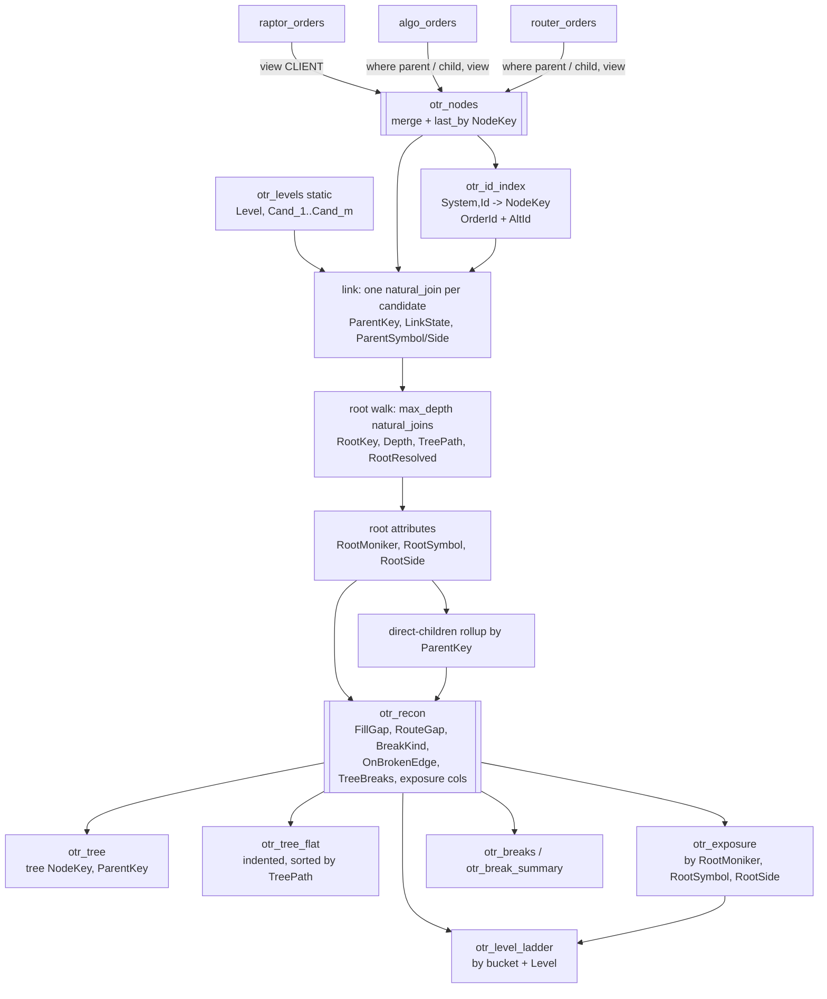

# 14 — Order tree reconciliation: Raptor → algo → order router (contract)

The question this answers:

> Orders flow from the **Raptor** FIX engine to an **algo server** (one parent, many
> children), and each algo child goes to an **order router** (which also has a parent and
> child orders on venues). Every downstream order carries an external order id from its
> upstream system. With all three systems' orders in Deephaven, what is the best way to
> show the **order tree** when I type a **moniker, symbol and side**, and to show the
> **reconciliation of each level's total `CumQty` and `LeavesQty`**, so I know the
> systems' exposure to **bought shares** and **open order shares**?

The submodule [`order-tree-recon/`](../order-tree-recon/) is the runnable answer. It runs
on mock Raptor / algo / router tables in their own native shapes, or on the three systems'
**FIX drop-copy messages** (section 12), and every number in this doc is checked against
the real engine (section 10). It is self-contained and can be exported into another
project with one script (section 13). This doc is **binding** for
that module the way docs 09 and 13 are for theirs: table names, column names and
formulas below are frozen, and a deviation updates this doc in the same change.

---

## 1. The answer in one screen

1. **Normalize, don't join pairwise.** Map each *level* (client order, algo parent,
   algo child, router parent, router child) onto one canonical **node** shape with one
   `view` per level, then `merge` them. Three systems and five levels become one table
   with one parent pointer per row. Pairwise joins (Raptor⋈algo, algo⋈router, …) can't
   handle DMA flow that skips a hop, and get worse with every system you add.
2. **Link through an id index, with ordered candidate systems.** `(System, Id) →
   NodeKey` over every id an order is known by. A level names the systems its parent
   may live in, in order: the router parent tries `ALGO` first, then `RAPTOR`, so DMA
   flow links without special cases.
3. **Find the root with bounded iterated joins.** One `natural_join` per level climbs
   the tree and yields `RootKey`, `Depth` and a depth-first `TreePath` for every node,
   incrementally. Anything deeper than the topology allows is flagged, not mis-rooted.
4. **Copy the root's moniker, symbol and side onto every node.** Only Raptor knows the
   moniker. Filtering on `RootMoniker`/`RootSymbol`/`RootSide` returns **whole trees**,
   all levels, for the moniker you type. Filtering each node on its own columns would
   lose every algo and router order (they carry no moniker) and tear the trees apart.
5. **Reconcile per edge, with signed gaps.** Compare each parent with the sum over its
   *direct* children: `FillGap = CumQty − ΣchildCumQty`,
   `RouteGap = LeavesQty − ΣchildLeavesQty`. The sign carries the meaning. More open
   below than above is over-exposure (red); less is just shares held (amber).
6. **Answer exposure per (moniker, symbol, side) and per level.** Client cum and leaves
   vs street cum and leaves, plus where the difference sits (held, over-routed,
   unbooked, phantom), with two identities that make the numbers add up (section 5.3).
7. **Show it as four panels on one filter:** an exposure table (one row per bucket), a
   level ladder, the native **tree table** (expand/collapse, recon columns on every
   node) and a breaks list. The tree only ships expanded rows to the browser, so the
   whole book needs no paging.

---

## 2. Topology: levels, systems, candidates

| Level | System (id namespace) | Parent may be in | Notes |
|---|---|---|---|
| `CLIENT` | `RAPTOR` | — (root) | the client order; the only level carrying the **moniker** |
| `ALGO_PARENT` | `ALGO` | `RAPTOR` | algo parent, links to Raptor's order id |
| `ALGO_CHILD` | `ALGO` | `ALGO` | algo slice, links to its algo parent (same namespace) |
| `OR_PARENT` | `OR` | `ALGO`, then `RAPTOR` | router parent; algo child id, or Raptor's id for **DMA** |
| `OR_CHILD` | `OR` | `OR` | venue order, **street** level: its open qty is market exposure |

`config.DEFAULT_LEVELS` holds exactly this list, and `config.parse_topology` validates
any other list (unique names, known parent systems, at least one root, a root can't be
the street level). Several levels can share a system: algo parents and children share
the `ALGO` namespace, which is why one `(System, Id)` index serves both the cross-system
hop (router parent → algo child) and the in-system hop (algo child → algo parent).

Tree depth is **data-driven**. A DMA tree is three levels deep and an algo tree five,
and an algo "sub-parent" (an algo child that has its own algo children) adds one more.
The root walk runs `max_depth = len(levels)` passes, which covers one nested algo level.
Anything deeper is `TOO_DEEP` (section 5.2).

## 3. The adapter contract — the only code you rewrite

Each level table handed to the DAG must carry `config.CANONICAL_COLUMNS`:

| Column | Type | Meaning |
|---|---|---|
| `OrderId` | string | this system's id for the order (unique within the system) |
| `AltId` | string | a second id a downstream system may reference (`""` if none) |
| `LinkId` | string | the id this order carries **for its parent**: the external order id for a cross-system hop, the parent order id inside a system, `""` at the root level |
| `Moniker` | string | client moniker; only the root level needs it |
| `Symbol`, `Side` | string | **one side coding across systems** (otherwise every child is a `MISMATCH`) |
| `OrderQty`, `CumQty`, `LeavesQty` | double | int/long are accepted, and nulls become `0.0` |
| `AvgPx` | double | null when nothing has filled |
| `Status`, `Destination` | string | display only (strategy for algo orders, venue for street orders) |

The mock adapters ([`sources.py`](../order-tree-recon/src/order_tree_recon/sources.py))
show every rule on purpose-built native shapes. Raptor uses FIX side codes and has both
`OrderId` and `ClOrdID`. The algo and router tables keep parents and children in one
table, with different column names:

```python
"CLIENT":      raptor.update_view([RAPTOR_SIDE]).view([
                   "OrderId", "AltId = ClOrdID", "LinkId = ``", "Moniker", "Symbol", "Side",
                   "OrderQty", "CumQty", "LeavesQty", "AvgPx", "Status = OrdStatus", "Destination = ``"]),
"ALGO_PARENT": algo.where("ParentAlgoOrderId == ``").view(["LinkId = RaptorOrderId", *algo_common]),
"ALGO_CHILD":  algo.where("!(ParentAlgoOrderId == ``)").view(["LinkId = ParentAlgoOrderId", *algo_common]),
"OR_PARENT":   router.where("ParentRouterOrderId == ``").view(["LinkId = UpstreamOrderId", *router_common]),
"OR_CHILD":    router.where("!(ParentRouterOrderId == ``)").view(["LinkId = ParentRouterOrderId", *router_common]),
```

Rules that matter in a real deployment:

- **Role split.** Use whatever parent/child flag your algo server and router really
  have. If an order matches two role filters, `last_by(NodeKey)` keeps the DAG alive,
  but the order shows up at only one level.
- **Which id a downstream system stores.** In the mock, the algo server stores Raptor's
  `OrderId` while DMA flow stamps Raptor's outbound `ClOrdID`. Index both (`AltId`), or
  the DMA router parents come out `ORPHAN`. If a cancel/replace rotates the id a
  downstream system stored, pass every id an order was ever known by as `extra_ids`
  (`System, Id, OrderId`) to `build_order_tree`. Current ids win a collision. The FIX
  layer does this for every OrderID, ClOrdID and OrigClOrdID (section 12).
- **The input tables can be anything that is a Deephaven table**: Kafka, a JDBC poll
  (doc 07), parquet, or a remote URI from other servers (doc 10). The DAG is
  incremental, so ticking sources need no code change (section 10, live-fill test).

## 4. The DAG



The steps, as implemented in [`dag.py`](../order-tree-recon/src/order_tree_recon/dag.py):

**4.1 Canonicalize.** One `view` per level (nulls become `""` or `0.0`) stamps `Level`,
`LevelNo`, `System`, `IsStreet` and `NodeKey = System + "|" + OrderId`. Then
`merge(...).last_by("NodeKey")`. The `last_by` is cheap insurance: `natural_join` throws
on duplicate right keys, and one duplicated order must not take the whole DAG down.

**4.2 Id index.**

```python
by_order = nodes.where("OrderId != ``").view(["System", "Id = OrderId", "NodeKey"])
by_alt   = nodes.where("AltId != ``").view(["System", "Id = AltId", "NodeKey"])
otr_id_index = merge([by_order, by_alt]).last_by(["System", "Id"])
```

**4.3 Parent resolution.** `otr_levels` has one `Cand_i` column per candidate position
(`""` when a level has fewer candidates). One `natural_join` per position probes the
index, and the first hit wins:

```python
linked = nodes.natural_join(otr_levels, on=["Level"], joins=["IsRootLevel", "Cand_1", "Cand_2"])
linked = linked.natural_join(otr_id_index, on=["Cand_1=System", "LinkId=Id"], joins=["Hit_1=NodeKey"])
linked = linked.natural_join(otr_id_index, on=["Cand_2=System", "LinkId=Id"], joins=["Hit_2=NodeKey"])
linked = linked.update([
    "ParentKey = !isNull(Hit_1) ? Hit_1 : (!isNull(Hit_2) ? Hit_2 : ((String) null))",
    "LinkState = IsRootLevel ? `ROOT` : (LinkId == `` ? `NO_LINK` : (isNull(ParentKey) ? `ORPHAN` : `LINKED`))",
])
```

The parent's own `Symbol`/`Side` are joined back on `ParentKey` (a diamond, not a cycle)
for the `MISMATCH` check.

**4.4 Root walk.** `Up` is the next ancestor still to visit:

```python
walked = linked.update(["RootKey = NodeKey", "Depth = (int) 0", "TreePath = NodeKey", "Up = ParentKey"])
for _ in range(topology.max_depth):
    walked = walked.natural_join(parent_map, on=["Up=NodeKey"], joins=["NextUp=ParentKey"]).update([
        "TreePath = isNull(Up) ? TreePath : Up + ` > ` + TreePath",
        "RootKey  = isNull(Up) ? RootKey : Up",
        "Depth    = isNull(Up) ? Depth : Depth + 1",
        "Up       = isNull(Up) ? Up : NextUp"]).drop_columns(["NextUp"])
walked = walked.update(["RootResolved = isNull(Up)"])
```

The separator starts with a space, and a space sorts before every printable character,
so a plain `sort("TreePath")` is a **depth-first pre-order walk**: each parent sorts
immediately before its own subtree. That gives the indented flat tree for free.

**4.5 Root attributes.** `walked.view(["RootKey = NodeKey", "RootMoniker = Moniker",
"RootSymbol = Symbol", "RootSide = Side", "RootLevel = Level", "RootOrderId = OrderId",
"RootLinkState = LinkState"])`, natural-joined back on `RootKey`.

**4.6 Direct-children rollup.** `where("!isNull(ParentKey)").agg_by([count_("ChildCount"),
sum_(["ChildOrderQty = OrderQty", "ChildCumQty = CumQty", "ChildLeavesQty = LeavesQty"])],
by=["ParentKey"])`. Only **direct** children count. Comparing a node with its whole
subtree would count the mid levels twice (the rule doc 09 also follows).

**4.7 Recon, second pass, exposure columns.** These are the section 5 formulas. A
second join pulls the parent's "edge broke" flag down to its children (`OnBrokenEdge`),
and a per-`RootKey` sum gives `TreeBreaks`, so "breaks only" can keep whole trees.

Everything is a join or an aggregation. When a fill ticks on one venue order, only that
tree's rows recompute.

## 5. Reconciliation semantics

### 5.1 The two gaps (per node, against its direct children)

| | Non-street node | Street node |
|---|---|---|
| `FillGap` | `CumQty − ΣchildCumQty` (no children: `CumQty`) | `0` |
| `RouteGap` | `LeavesQty − ΣchildLeavesQty` (no children: `LeavesQty`) | `0` |

`HeldQty = max(RouteGap, 0)`, `OverRoutedQty = max(−RouteGap, 0)`,
`UnbookedQty = max(−FillGap, 0)`, `PhantomQty = max(FillGap, 0)`, all per node, then
summed. Positive and negative parts are summed separately, so an over-routed slice and
a held slice never cancel each other out.

### 5.2 The break taxonomy (priority order, first match wins)

| `BreakKind` | Condition | What it means for exposure | Colour |
|---|---|---|---|
| `ORPHAN` | `LinkId` set, resolves to nothing | the order (and everything under it) has no client attached; its street qty is **unattributed exposure** | red |
| `NO_LINK` | non-root level, empty `LinkId` | same, and the upstream system never stamped the id | red |
| `TOO_DEEP` | root not reached in `max_depth` passes (or a data cycle) | would otherwise inherit a blank moniker and vanish from searches | red |
| `MISMATCH` | `Symbol`/`Side` ≠ parent's | a child working the wrong instrument or direction | red |
| `OVERFILL` | `CumQty > OrderQty` | executed beyond the order size | red |
| `UNBOOKED_FILL` | `FillGap < 0` | children executed more than this order shows: **shares bought/sold that upstream has not booked** (missed or late execution report) | red |
| `PHANTOM_FILL` | `FillGap > 0` | this order shows fills its children don't explain (a bust that didn't propagate, an internal cross) | red |
| `CHILD_STILL_OPEN` | `RouteGap < 0` and own `LeavesQty = 0` | parent is done or canceled but a child is still working: **the cancel didn't propagate** | red |
| `OVER_ROUTED` | `RouteGap < 0` | more open below than above: **overfill risk** | red |
| `HELD` | `RouteGap > 0` | open here, not routed further (algo schedule, unrouted client order) | amber |
| `NONE` | edge reconciles | | — |

`UNBOOKED_FILL`, `PHANTOM_FILL`, `CHILD_STILL_OPEN` and `OVER_ROUTED` are **edge**
kinds: they are computed on the parent against its children, and the children get
`OnBrokenEdge = true` so both ends of the discrepancy light up.

**Why the gaps are signed.** Doc 09's taxonomy flags `abs(DeltaLeavesQty) > tol` as
amber `UNROUTED`. That is right for a pure "is the edge clean" view, but an exposure
view must split the two cases: shares sitting in the algo (fine) and more shares on the
street than the client wants (an overfill waiting to happen). Under `abs()` an over-route
is amber. Here it's red `OVER_ROUTED`, or `CHILD_STILL_OPEN` when the parent is already
closed. (Doc 09's blotter is unchanged. If its users care about over-routes, porting
the sign split means one more branch in its `BreakKind` formula plus the taxonomy constants.)

### 5.3 The identities: why the numbers add up

For a tree whose every node is linked (street nodes have no children), summing the
per-node gaps over the tree telescopes. Every non-root node's leaves appear once as a
child term and once as its own term:

```
ClientLeavesQty = Σ RouteGap + StreetLeavesQty = HeldQty − OverRoutedQty + StreetLeavesQty
ClientCumQty    = Σ FillGap  + StreetCumQty    ⇒  StreetCumQty − ClientCumQty = UnbookedQty − PhantomQty
```

So, per (moniker, symbol, side):

- **open order shares**: the client wants `ClientLeavesQty`. `StreetLeavesQty` of it is
  live on venues, `HeldQty` sits in Raptor/algo/router, and `OverRoutedQty` is working
  on the street *beyond* what the client has open;
- **bought (or sold) shares**: the street executed `StreetCumQty` and the client was
  booked `ClientCumQty`. The difference, `NetUnbookedQty`, is the firm's own position
  until booked, and `UnbookedQty`/`PhantomQty` say which edges created it.

Both identities are unit-tested on every complete bucket, and the embedded test asserts
the engine produces the same numbers (section 10). A bucket with an orphan doesn't
satisfy them by construction (the orphan's client is unknown), which is exactly why
unlinked trees are counted (`UnlinkedTrees`) and shown.

## 6. The exposure tables

**`otr_exposure`**: one row per `(RootMoniker, RootSymbol, RootSide)`:

| Column | Answers |
|---|---|
| `ClientOrderQty`, `ClientCumQty`, `ClientLeavesQty` | what the client asked for, was booked, still has open (Raptor, root orders only) |
| `StreetCumQty`, `StreetLeavesQty` | executed on venues, live on venues (`OR_CHILD`) |
| `NetUnbookedQty` | `StreetCumQty − ClientCumQty` — **bought/sold shares not on the client order** |
| `StreetOpenVsClient` | `StreetLeavesQty − ClientLeavesQty` — negative while shares are held upstream; **positive = more working on the street than the client wants** |
| `HeldQty`, `OverRoutedQty`, `UnbookedQty`, `PhantomQty` | where the differences sit |
| `Breaks`, `Trees`, `UnlinkedTrees`, `Orders` | red nodes, root count, roots that are not client orders |

**`otr_level_ladder`**: one row per bucket and level, with `Orders`, `OrderQty`,
`CumQty`, `LeavesQty`, `ExecNotional`, the four gap sums, `Breaks`, and
`CumVsClient`/`LeavesVsClient` (each level's total minus the bucket's client total).
This is the literal "each level's total" view. Read it with one caveat: level totals
only match the client when **all** flow passes through that level. DMA flow skips the
algo levels, so `ALGO_*` legitimately sums less. The per-edge gap columns are the
attribution that stays correct with DMA. The totals are the at-a-glance picture.

Example (scenario `unbooked_fill`, CEDAR / JPM / BUY):

```
Level        Orders OrderQty CumQty LeavesQty HeldQty UnbookedQty Breaks CumVsClient LeavesVsClient
CLIENT            1      900    800       100       0           0      0           0              0
ALGO_PARENT       1      900    800       100       0           0      0           0              0
ALGO_CHILD        3      900    800       100       0           0      0           0              0
OR_PARENT         3      900    800       100     100         100      1           0              0
OR_CHILD          3      900    900         0       0           0      0         100           -100
```

The street executed 900 and everything above it says 800: the router parent lost the
last fill report. The firm is long 100 shares the client doesn't have, and the client
order still shows 100 open that isn't open anywhere.

`Table.rollup` was rejected for the ladder. Its parent rows sum across children, so the
`Side` node of a `Moniker > Symbol > Side > Level` rollup would add the same shares
once per level (five times over). Ladder and exposure are flat aggregations instead.

## 7. The UI (`order_tree_dashboard`)

```
┌──────────────────────────────────────────────────────────────────────────────────┐
│ Moniker [du___v] Symbol [____v] Side [any v] Any order id [______] [x]unlinked [ ]breaks │
├────────────────────────────────────────┬─────────────────────────────────────────┤
│ Exposure by moniker / symbol / side    │ Level ladder                            │
│ (press a row to pin the bucket)        │                                         │
├────────────────────────────────────────┼─────────────────────────────────────────┤
│ Order tree — native, expand/collapse   │ Breaks in view                          │
│ ▾ CLIENT       RPT-00007  NONE         │ CHILD_STILL_OPEN OR_PARENT OR-00013 …   │
│   ▾ ALGO_PARENT ALG-00005 NONE         │                                         │
│     ▾ ALGO_CHILD …-01     NONE         │                                         │
│       ▾ OR_PARENT OR-00013 CHILD_STILL_OPEN  RouteGap −100                       │
│           OR_CHILD OR-00013.1 CANCELED                                           │
│           OR_CHILD OR-00013.2 PARTIALLY_FILLED  LeavesQty 100                    │
└────────────────────────────────────────┴─────────────────────────────────────────┘
```

- **One filter, four tables.** Moniker and symbol are type-in combo boxes fed by
  `otr_moniker_list`/`otr_symbol_list` with a case-insensitive **prefix** match, so
  typing `du` already shows DUNE. Side is a picker. All three match the **root's**
  attributes, and pressing an exposure row pins its exact bucket.
- **include unlinked** (default on) adds trees whose root isn't a client order (orphans)
  to a moniker search, as long as they match the symbol and side. An orphan router order
  can't inherit a moniker, and it is exactly the order a moniker search must not hide.
- **breaks only** keeps whole trees that contain a red node (`TreeBreaks > 0`), never
  isolated nodes.
- **Any order id** resolves an id from *any* system through `otr_id_index` and shows that
  whole tree, narrowing every panel to its bucket. You can start from a venue order id
  and see the client order.
- **Native tree table** (`Table.tree(NodeKey, ParentKey, promote_orphans=True)`) with
  `BreakKind`, the quantities and both gaps right after the order id. Formatting is
  applied before `.tree()` and survives it. `promote_orphans` matters: without it an
  orphan's venue subtree would vanish.
- **No hand-rolled paging.** Deephaven grids are viewport-virtualized, and a tree table
  only ships the rows of expanded nodes, so the whole book costs the browser one row
  per root. (Doc 09 hard-pages because its TODO asked for it. A tree doesn't need it.)
- `otr_tree_flat` is the same trees as a normal table: sorted by `TreePath`, with a
  `Tree` column indented by `Depth`. It pages, filters and row-presses like any table,
  and it is what `order_tree(...)["flat"]` and `find_tree(...)` return.

**A `deephaven.ui` lesson, found in the browser.** A combo box with a *controlled*
`input_value` round-trips every keystroke through the server, and a fast second
keystroke gets overwritten by the stale render (`du` showed up as `u`). The inputs are
therefore uncontrolled (`default_input_value` / `default_value`) with a `key` that is
bumped when a row press or *Clear* needs to set their text, which remounts them.

## 8. Query API (globals)

| Function | Returns |
|---|---|
| `order_tree(moniker=None, symbol=None, side=None, include_unlinked=True)` | `{"tree", "flat", "ladder", "exposure", "breaks"}`: exact match on each given value |
| `find_tree(any_id)` | the whole tree(s) containing an id from any system, as `otr_tree_flat` rows |
| `exposure(moniker=None, symbol=None, side=None)` | `otr_exposure` rows (with a moniker, unlinked buckets are not added) |

All values go through `sanitize_id` (doc 09's rules) before reaching a query string.

## 9. Configuration and deployment

| Variable | Default | Meaning |
|---|---|---|
| `OTR_QTY_TOL` | `1e-6` | absolute tolerance for every quantity comparison |
| `OTR_SEED` | `42` | mock data seed |
| `OTR_MOCK_FAMILIES` | `24` | random healthy families on top of the scenario catalog |
| `OTR_SOURCE` | `mock` | `mock`, or `fix-files`: FIX drop-copy logs (section 12) |
| `OTR_FIX_DIR` | `/otr-fix` | where `fix-files` reads; compose mounts `OTR_FIX_HOST_DIR` (default `order-tree-recon/fix-samples`) there |
| `OTR_FIX_CONFIG` | `<OTR_FIX_DIR>/fix_config.json` | the tag mapping; the built-in `fix.DEFAULT_FIX_CONFIG` if that file does not exist |

A malformed value is a startup error. The topology is code (`config.DEFAULT_LEVELS`),
not an environment variable, because it is coupled to the adapters.

- App folder `docker/apps/order-tree-recon/` (`.app` id `fix42.order.tree.recon`,
  `main.py` → shared loader → `/otr-scripts/order_tree_recon/app.py`).
- `docker/docker-compose.order-tree.yml`: one Deephaven service on the stock
  `ghcr.io/deephaven/server:42.4` image, no broker. `order-tree-recon/scripts/run_demo.sh
  [up|down|status|logs]` wraps it.
- Gradle: `include(":order-tree-recon")`. The module wraps its pytest suite like
  `:basket-oms-demo` (`base` plugin, `pytest` Exec task wired into `check`).

## 10. Verification

- **Reference oracle.** [`reference.py`](../order-tree-recon/src/order_tree_recon/reference.py)
  computes every `otr_recon` column, the ladder and the exposure table with dicts and
  loops. 114 host tests pin it down: every scenario's expected breaks, the edge taxonomy
  case by case, signed gaps, DMA via `AltId`, candidate order, nested algo, `TOO_DEEP`
  and cycles, depth-first `TreePath`, both identities on every complete bucket, the
  filter builders and the mock book's invariants. For the FIX layer: the parser, config
  validation, the fold, the id history, `fix_check`, and the mock book written as FIX
  tapes, which reconciles exactly like the table path (every column but `AltId`).
- **Embedded engine** (`OTR_DH_TEST=1`, `deephaven-server==42.4`). The DAG matches the
  reference **row for row**: 340 nodes × 54 columns, 132 ladder rows, 29 exposure rows,
  zero differences. Also covered: tree, query API and app entrypoint. A **live-fill**
  test makes the router table a keyed input table and adds one venue fill the router
  parent never booked. The parent turns `UNBOOKED_FILL` and the bucket's
  `NetUnbookedQty` becomes 100 incrementally, with no rebuild. For the FIX path, the
  engine's fold of the raw messages (with a null, garbage and a report without an
  OrderID mixed in) equals the python fold row for row, the tree it builds equals the
  reference on every `otr_recon` column, and an appended ExecutionReport on an
  append-only message table ticks through to `UNBOOKED_FILL`. `OTR_SOURCE=fix-files`
  builds the app and dashboard from `fix-samples/`.
- **Browser.** The app was loaded through the same loader path Application Mode uses
  and driven in headless Chromium: typing a prefix, pinning a bucket by row press,
  expanding a tree to the venue level, searching by a venue order id. The
  controlled-input bug in section 7 was found and fixed this way.

The scenario catalog ([`mockdata.py`](../order-tree-recon/src/order_tree_recon/mockdata.py)):

| Scenario | Bucket | Expected |
|---|---|---|
| `clean_filled` | ACME AAPL BUY | all `NONE` |
| `working` | ACME MSFT BUY | `HELD` on the algo parent (1 200 not yet released) |
| `dma` | BLUEFIN NVDA SELL | Raptor → router directly via `ClOrdID`, all `NONE` |
| `unrouted_client` | BLUEFIN AMZN BUY | `HELD` on the client order |
| `unbooked_fill` | CEDAR JPM BUY | `UNBOOKED_FILL` on one router parent, `NetUnbookedQty = 100` |
| `over_routed` | CEDAR AAPL SELL | `OVER_ROUTED`: two venue orders of 200 under a 300 router parent |
| `cancel_not_propagated` | DUNE MSFT BUY | `CHILD_STILL_OPEN`: everything canceled but one venue order with 100 open |
| `orphan` | (none) NVDA BUY | `ORPHAN` router parent: an unattributed bucket with 200 live on the street |
| `side_mismatch` | ACME NVDA BUY | `MISMATCH` on a SELL venue order under a BUY parent |
| `overfill` | BLUEFIN JPM SELL | `OVERFILL` on the router parent and `UNBOOKED_FILL` on the algo child that capped at its size |
| `nested_algo` | CEDAR NVDA BUY | an algo sub-parent, depth 5, all `NONE` |

## 11. Production notes

- **Transient gaps.** Fills propagate up the chain in milliseconds to seconds, so a
  live book shows short-lived `UNBOOKED_FILL`s. If that is noise, carry each system's
  last-update time through the adapters and flag a gap only once it is older than N
  seconds (`update_view` with `now()`, or a time-based `where` on a ticking clock).
  The structure doesn't change.
- **Internal fills.** An algo cross or a facilitation fill at a non-street level is a
  `PHANTOM_FILL` by construction (the fills don't come from the street). Model the
  internal book as its own street level (one more topology entry and adapter), or
  whitelist it.
- **Scale.** The DAG is a few `natural_join`s per level plus three aggregations. Memory
  is roughly the node table plus a handful of columns per node. For hundreds of millions
  of orders across servers, doc 10's split applies: leaves hold their systems' node
  tables, and a collector runs this DAG over the subscribed union.
- **Id collisions across namespaces** are harmless (the index is per system). Within one
  system, an `AltId` that equals another order's `OrderId` resolves to the `AltId` owner,
  so keep id schemes distinct.
- **Relationship to doc 09.** Doc 09 folds FIX drop-copy tapes through a full state
  machine (one hub's OMS view). This module reads current-state order tables, wherever
  they come from, and since section 12 also reads drop copies directly with a much
  lighter fold (latest report wins). A doc 09 deployment can still feed it by mapping
  `oms_orders_latest` per hub through adapters (`LinkId = ExtOrdID`).

## 12. Real FIX messages

When the three systems' orders exist only as FIX drop copies, the FIX layer turns raw
messages into the five level tables. Everything from section 4 on is unchanged.

```
FIX logs, a Kafka topic, ... -- any table with a string column RawFix, one message per row
   └─ fix_dag.fix_level_tables(topology, fix_config, {"RAPTOR": t1, "ALGO": t2, "OR": t3})
        ├─ one table per level (the section 3 contract) ──┐
        └─ extra_ids: System, Id, OrderId ────────────────┴─> dag.build_order_tree(..., extra_ids=...)
```

`fix_dag.build_from_fix(topology, fix_config, messages)` does both steps in one call.
`OTR_SOURCE=fix-files` calls it on log files (section 12.3).

### 12.1 How messages become orders

An ExecutionReport (35=8) carries the order's **cumulative** state: OrdStatus (39),
OrderQty (38), CumQty (14), LeavesQty (151), AvgPx (6). So an order's current state is
just its latest report, keyed by a stable order id: OrderID (37) by default, which FIX
4.2 keeps across a cancel/replace. No state machine is needed. A trade bust or
correction is itself a report that restates CumQty / LeavesQty, so it lands correctly.

| Field | Rule | Column |
|---|---|---|
| 11, 39, 38, 14, 151, 6, 55, 54, `destination_tag` | latest **non-empty** value per order | `AltId`, `Status`, `OrderQty`, `CumQty`, `LeavesQty`, `AvgPx` (null unless CumQty > 0), `Symbol`, `Side`, `Destination` |
| `moniker_tag`, every `link_tag` and `when` tag | **first** non-empty value per order | `Moniker`, `LinkId`, the level |
| every `id_tags` value (37, 11, 41) | all of them | `extra_ids`: the id history |

- Only 35=8 with a non-empty order id is used. Requests (D/F/G), heartbeats and other
  messages are skipped.
- Side and OrdStatus codes are decoded to names (`1` → `BUY`, `5` → `SELL_SHORT`,
  `4` → `CANCELED`, ...), so all three systems share one coding. A malformed number
  reads as empty, never as an error.
- **First** non-empty for links and the moniker: firms often stamp custom tags on the
  first report only, and a parent link does not legitimately change.
- **The id history** is why a cancel/replace never breaks a link. If a downstream order
  still names the upstream's original ClOrdID, that id stays in the upstream's index.
  The samples show it: the `dma` client order and its router parent are both replaced,
  the router parent links through its original ClOrdID, and without `extra_ids` it would
  be `ORPHAN`.
- Parsing is tolerant: SOH, `|` or `^A` delimiters, and any prefix before `8=FIX`
  (QuickFIX timestamps, session names). The first occurrence of a tag wins.
- On the engine, one python UDF call per message picks the configured tags into string
  columns. The rest is `where` / `last_by` / `first_by` / `natural_join`, so a ticking
  message table gives ticking order state, and a live feed only parses new messages.
  Measured on the test machine: 200 000 router messages picked in 6.6 s and folded in
  8.3 s in total. Parsing is the cost, and that is fine for a day of drop copies.

### 12.2 The mapping config

One JSON file maps each system's tags. This is the default (`fix.DEFAULT_FIX_CONFIG`,
also `fix-samples/fix_config.json`):

```json
{"systems": [
  {"system": "RAPTOR", "files": ["raptor*.log"], "moniker_tag": "1", "levels": [
    {"level": "CLIENT"}
  ]},
  {"system": "ALGO", "files": ["algo*.log"], "destination_tag": "847", "levels": [
    {"level": "ALGO_CHILD", "when": {"tag": "20001"}, "link_tag": "20001"},
    {"level": "ALGO_PARENT", "link_tag": "11"}
  ]},
  {"system": "OR", "files": ["router*.log"], "levels": [
    {"level": "OR_CHILD", "when": {"tag": "20001"}, "link_tag": "20001"},
    {"level": "OR_PARENT", "link_tag": "11"}
  ]}
]}
```

How to read it: a **cross-system** parent link is the downstream order's own ClOrdID
(11), the id the upstream sent the order with. The upstream reports that id as its
OrderID or as one of its ClOrdIDs, and both are in its id index. An **in-system** child
names its parent in a custom tag (20001 here). Each level is chosen by its `when`; the
first match wins, and a level without `when` is the system's default.

| Key (per system) | Default | Meaning |
|---|---|---|
| `system` | required | a topology system: `RAPTOR`, `ALGO`, `OR` |
| `files` | `[]` | globs relative to the FIX directory |
| `levels` | required | `[{"level", "when"?, "link_tag"?}]`; every topology level mapped exactly once |
| `order_id_tag` | `"37"` | the stable per-order key |
| `id_tags` | `["37", "11", "41"]` | every id other systems may reference this order by |
| `moniker_tag` | `"1"` (Account) | `null`: no moniker; only the root level needs one |
| `destination_tag` | `"100"` (ExDestination) | display only (strategy for algo, venue for street); `null`: none |

`when` is `{"tag": T}` (the tag is present) or `{"tag": T, "equals": "V"}`. Root levels
take no `link_tag`; every other level needs one. A firm whose algo server flags children
in tag 9100 and names the parent in 9101 writes:

```json
{"system": "ALGO", "files": ["algo_dropcopy_*.log"], "destination_tag": "847", "levels": [
  {"level": "ALGO_CHILD", "when": {"tag": "9100", "equals": "CHILD"}, "link_tag": "9101"},
  {"level": "ALGO_PARENT", "link_tag": "11"}
]}
```

`fix.parse_fix_config` validates all of it at startup and names the system, level and
field at fault. A typo is an error, never a silently empty level.

### 12.3 Pointing it at your logs

1. **Collect** each system's drop-copy logs into one folder. Every line containing
   `8=FIX` is one message, and several files per system are fine (`algo_*.log`). Keep
   that folder outside the repository: real drop copies hold client orders. `*.log` is
   git-ignored everywhere except `fix-samples/`.
2. **Find your tags.** Look at a few ExecutionReports per system:
   `grep -m5 '35=8' algo.log | tr '\001|' '\n\n' | sort -u` (SOH or `|`). For each
   level, decide which tag tells you it is that level, and which tag names its parent.
   For a cross-system hop that is usually 11; inside a system it is usually custom.
3. **Write `fix_config.json`** in the same folder, starting from
   `order-tree-recon/fix-samples/fix_config.json`.
4. **Dry-run it on the host** (pure python, no Deephaven, no container):

   ```bash
   cd order-tree-recon
   PYTHONPATH=src python -m order_tree_recon.fix_check /path/to/logs
   ```

   It prints the files each glob matched, the orders per level, `ROOT` / `LINKED` /
   `ORPHAN` / `NO_LINK` counts, the breaks, and the first unlinked orders with the
   reason (`link tag 11 = 'X', not an id of any ALGO / RAPTOR order`, or
   `link tag 9101 is on none of its ExecutionReports`). Iterate on the config until the
   links look right.
5. **Run the dashboard on them:**

   ```bash
   OTR_SOURCE=fix-files OTR_FIX_HOST_DIR=/path/to/logs bash order-tree-recon/scripts/run_demo.sh
   ```

   The banner lists the files and message counts per system. The raw messages are
   globals too (`fix_raptor_messages`, `fix_algo_messages`, `fix_or_messages`).

### 12.4 Live feeds

The fold needs every message of the day (first values, id history), so a live source
must be an **append** table, never a blink table. With Kafka (one topic per system, the
message as the record value):

```python
from deephaven import dtypes
from deephaven.stream.kafka import consumer as kc
from order_tree_recon import config, fix, fix_dag, query_api
from order_tree_recon.dashboard import build_dashboard

def drop_copies(topic):
    return kc.consume(
        {"bootstrap.servers": "kafka:9092"}, topic,
        offsets=kc.ALL_PARTITIONS_SEEK_TO_BEGINNING,       # replay the day
        key_spec=kc.KeyValueSpec.IGNORE,
        value_spec=kc.simple_spec("RawFix", dtypes.string),
        table_type=kc.TableType.append(),
    )

topology = config.default_topology()
fix_config = fix.load_fix_config("/otr-fix/fix_config.json", topology)
tables = fix_dag.build_from_fix(topology, fix_config, {
    "RAPTOR": drop_copies("raptor.dropcopy"),
    "ALGO": drop_copies("algo.dropcopy"),
    "OR": drop_copies("router.dropcopy"),
})
globals().update(tables)
globals().update(query_api.make_query_api(tables))
order_tree_dashboard = build_dashboard(tables)
```

Any other append-only table with a `RawFix` column works the same way: an input table,
or a table publisher your FIX engine writes to. Order the messages of one order in time
within its table (file order, or one Kafka partition per order).

### 12.5 What the FIX layer assumes

- **Standard FIX 4.2 state tags** (11, 39, 38, 14, 151, 6, 55, 54). A system that
  reports, say, the symbol elsewhere needs `FixSystem.state_tags` and the canonical view
  in `fix_dag._system_tables` (and its twin `fix.fold_system`) changed in one place each.
- **A stable order key per system.** If a system issues a new OrderID on every replace,
  set `order_id_tag` to a tag that is stable (an internal order id). Otherwise each
  replace shows up as a new order.
- **Unique ids within a system.** ClOrdIDs are unique per FIX session. Two sessions
  feeding one system can collide; current ids beat history, but give such sessions
  distinct `system` names or prefixes if they reuse ids.
- `AltId` becomes the latest ClOrdID for every system. That is harmless, because the
  index is per system and holds every id anyway.

## 13. Using the module in another project

The module is self-contained. The `order_tree_recon` package imports only the standard
library, `deephaven` and `deephaven.ui` (the dashboard only), and has no pip
dependencies. The pure modules (`config`, `reference`, `mockdata`, `fix`, `fix_mock`,
`fix_check`, the filter builders) run on any Python 3.10+. What it borrows from this
repository is four small pieces of scaffolding: the compose file, the app folder with
the shared loader, `repos.env` with `scripts/repos.sh` (doc 15), and `.gitattributes`.

**Export it** with everything it needs, keeping the relative layout so every path still
works:

```bash
bash order-tree-recon/scripts/export_standalone.sh ~/work/order-tree   # --force to overwrite
cd ~/work/order-tree
bash order-tree-recon/run_tests.sh
bash order-tree-recon/scripts/run_demo.sh
```

`DEST` gets `order-tree-recon/`, `docker/` (compose, loader, app folder), `scripts/repos.sh`,
`repos.env`, `repos.local.env.example`, docs 14 and 15, `.gitattributes`, a `.gitignore`
and a README. Into an existing project, files that already exist are kept unless you
pass `--force`, and `.gitignore` only gets the missing lines appended. It leaves out
`build.gradle.kts` (it plugs into this repo's Gradle build), virtualenvs and caches, and
your `repos.local.env`, which may hold credentials. The export was tested by exporting,
running the exported test suite, resolving the exported compose file with and without a
JFrog override, and re-exporting from the export.

**Into an existing Deephaven server**, no compose needed. Put `order-tree-recon/src` on
the server's `PYTHONPATH` (mount it, or `pip install ./order-tree-recon` into the
server's venv), then from the console or your own Application Mode script:

```python
from order_tree_recon import app
app.main(globals())                 # honours OTR_SOURCE / OTR_FIX_DIR / ... (section 9)
```

Or, as a library:

```python
from order_tree_recon import config, dag, fix, fix_dag, query_api
topology = config.default_topology()
# from FIX messages (section 12): {system: table with a RawFix column}
tables = fix_dag.build_from_fix(topology, fix.load_fix_config("fix_config.json", topology), messages)
# or from order tables already in Deephaven (section 3): {level: canonical table}
tables = dag.build_order_tree(topology, level_tables)
api = query_api.make_query_api(tables)     # order_tree / find_tree / exposure
```

What you change for your firm is one of: the FIX mapping config (section 12), or the
adapters in `sources.py` (section 3). Change `config.DEFAULT_LEVELS` only if your flow
has a different shape. The DAG, the API and the dashboard stay as they are.

## 14. Module layout

```
order-tree-recon/
├── README.md                    # runbook
├── build.gradle.kts / pyproject.toml / run_tests.sh
├── fix-samples/                 # the mock book as FIX 4.2 drop copies + fix_config.json
├── scripts/run_demo.sh          # podman compose up | down | status | logs
├── scripts/export_standalone.sh # section 13
├── src/order_tree_recon/
│   ├── config.py                # pure: levels, topology validation, taxonomy, OTR_* env
│   ├── reference.py             # pure: the oracle of every DAG formula
│   ├── mockdata.py              # pure: native Raptor / algo / router tables + scenarios
│   ├── query_api.py             # pure filter builders + the console API
│   ├── fix.py                   # pure: FIX parser, mapping config, fold (python twin)   <- section 12
│   ├── fix_mock.py              # pure: the mock book as FIX tapes (writes fix-samples/)
│   ├── fix_check.py             # pure: dry-run a mapping on your logs
│   ├── fix_dag.py               # FIX messages -> level tables + id history, in Deephaven
│   ├── sources.py               # native tables + per-level adapters  <- rewrite for real tables
│   ├── dag.py                   # section 4
│   ├── dashboard.py             # section 7
│   └── app.py                   # Application-Mode entrypoint (OTR_SOURCE=mock | fix-files)
└── tests/                       # host suite + the opt-in embedded-engine suite
```
