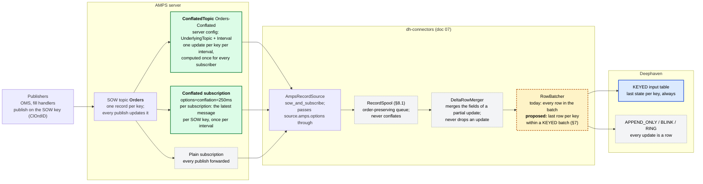
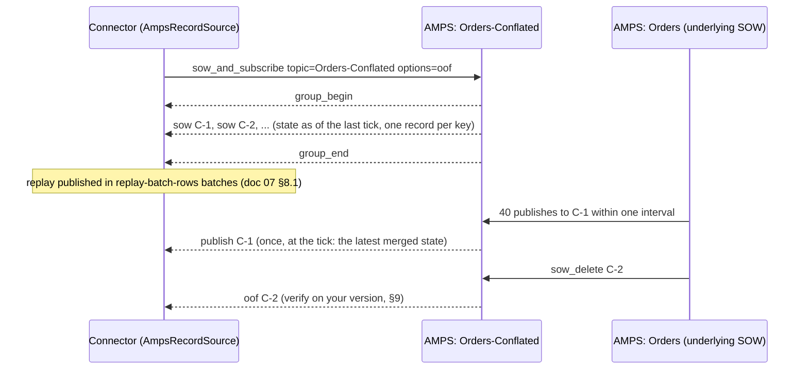

# 16 — AMPS conflation: collapsing same-key bursts before they reach Deephaven

An order that fills a hundred times in a second produces a hundred publishes to one SOW key,
and a keyed Deephaven table that will only ever show the last of them. Doc 07 §8.1 made that
burst *safe* — the spool keeps the AMPS socket drained and the replay goes out in large batches
— but it still moves every one of those hundred rows through the pipeline and into a Flight
call. **Conflation** is the lever that removes the rows instead: AMPS can collapse a burst of
updates to the same key into one message per interval, either on the subscription or in a
dedicated conflated topic.

This doc is an analysis and a how-to, not a binding contract. It says where a same-key burst
can be collapsed, where it must not be, and gives the configuration and client snippets for
both AMPS mechanisms. Element and option names follow AMPS 5.x; §9 is the checklist for
confirming them against the server version you run.

## 1. Where conflation can happen — the flow

Green: collapses a burst today, on the AMPS server. Blue: absorbs duplicates by its own
semantics. Amber, dashed: proposed in the connector, not built. Grey: must never conflate.



| Component | Conflates? | Why |
|---|---|---|
| **Conflated subscription** (`conflation=` option) | yes, per subscription | AMPS holds updates for the interval and delivers the latest message per SOW key |
| **ConflatedTopic** (server config) | yes, once for all subscribers | a server-side view of the underlying topic, throttled to its `Interval` |
| Plain subscription | no | every publish is forwarded as it happens |
| `AmpsRecordSource` | passes it on | adds `oof`, appends `source.amps.options`, issues the command |
| `RecordSpool` | no, by design | an order-preserving queue; collapsing inside it would reorder an older record behind a newer one |
| `DeltaRowMerger` | no | merges the *fields* of a partial update over the stored row; every update still produces a row |
| `RowBatcher` | not today; §7 proposes it | within one batch run of upserts to a keyed table, only the last row per key matters |
| `KEYED` table | absorbs | an add replaces that key's row, so duplicates cost bandwidth, not correctness |
| `APPEND_ONLY`, `BLINK`, `RING` | never | each update is meant to be its own row; conflation would drop data these tables exist to keep |

## 2. What a burst looks like, with and without conflation

```
order C-1 filled 100 times in one second

publishes to AMPS           ████████████████████████████████████████   100 updates of one SOW key
plain subscription          ████████████████████████████████████████   100 messages -> 100 upserts of row C-1
conflation=250ms            █         █         █         █            4 messages: the state at each tick
                            |<-250ms->|

Executions topic, key ExecID
plain or conflated          ████████████████████████████████████████   100 distinct keys: nothing to collapse,
                                                                        and nothing that should be
```

Three things follow from the picture:

- **The reduction is burst rate × interval.** A key updated 100 times a second under a 250 ms
  interval reaches the connector 4 times. A key updated once a second is untouched.
- **The cost is latency, bounded by the interval.** The dashboard sees a fill up to one interval
  late. With `flush-interval: 250ms` on the Deephaven side as well, the worst case from publish
  to table is roughly the two intervals added together; tune them as one budget.
- **Conflation is a property of state topics.** It helps where many updates describe one entity
  — an order whose `CumQty` and `LeavesQty` move on every fill, a position moved by every trade.
  An events topic such as executions keyed by `ExecID` gains nothing, because every message is
  a new key, and losing a fill would be a defect rather than a saving. Conflate the state topics
  and leave the event topics alone.

The SOW replay that opens a `sow_and_subscribe` is **already one record per key**, so conflation
never shortens a replay. That is what the replay batching of doc 07 §8.1 is for. Conflation
shrinks the *live* stream, which in turn means the spool's disk tier is reached only during a
replay, if at all.

## 3. The two AMPS mechanisms, compared

| | Conflated subscription | Conflated topic |
|---|---|---|
| Configured by | the subscriber, per subscription | the AMPS administrator, in the server config |
| Interval | chosen by each subscriber | fixed for the topic; one value for everyone |
| Work on the server | one conflation state per subscription | one for the topic, shared by all its subscribers |
| Content filter | the subscription's own `filter` | the topic's `Filter`, plus each subscription's own |
| SOW query / replay | the underlying SOW, one record per key | the conflated topic's own state, one record per key |
| Delta subscriptions | AMPS merges the deltas of the interval into one message | subscribe to it with `sow_and_delta_subscribe` like any SOW topic |
| Change without a server restart | yes: it is just a subscription option | no: a config change the administrators deploy |
| Best for | one consumer with its own latency budget, no server access | many consumers wanting the same throttled view, or a server where per-subscription conflation would cost too much |

## 4. Option A — a conflated subscription (per connector, no server change)

### 4.1 Connector configuration

The AMPS block already passes extra subscription options through, so this is a one-line
change per connector:

```yaml
dh-connectors:
  connectors:
    - name: orders-fix
      format: FIX
      source:
        amps:
          host: ${AMPS_HOST:localhost}
          port: 9007
          topic: Orders
          sow: true
          subscription-mode: FULL
          # Extra AMPS subscription options, appended to the ones the connector derives (oof).
          # conflation=<interval>: AMPS holds updates and delivers the latest message per SOW
          # key once per interval. Live stream only -- the SOW replay is already one per key.
          options: conflation=250ms
      deephaven:
        table: amps_orders
        table-type: KEYED
        key-columns: [ClOrdID]
        flush-interval: 250ms        # publish-to-table latency is roughly this plus the conflation
```

For a topic **without** a SOW, AMPS needs to be told what to conflate on:

```yaml
          options: conflation=250ms,conflation_key=[/Symbol]
```

A delta subscription (`subscription-mode: DELTA`, which doc 07 §4 pairs with
`deephaven.publish-mode: DELTA`) conflates too: AMPS merges the deltas that arrived during the
interval into one message, and `DeltaRowMerger` lays it over the stored row as usual.

### 4.2 What goes on the wire

`AmpsRecordSource.buildCommand` issues `sow_and_subscribe` for a SOW topic with the options
string from `optionsFor`: the `oof` the connector always wants, then whatever `options:` holds.
With the configuration above the command carries

```
sow_and_subscribe  topic=Orders  options=oof,,conflation=250ms
```

The doubled comma is because the 60East client's `Message.Options.OOF` constant is the string
`"oof,"` — the client's option constants carry their own separator so they can be concatenated
— and `optionsFor` joins it to your options with another comma. AMPS accepts the empty token
(the client's own idiom produces a trailing one on every subscription), so the subscription
works as is. A one-line normalisation keeps the wire string tidy and lets the test assert it
exactly; proposed, not yet applied:

```java
    // AmpsRecordSource
    private static String optionsFor(AmpsSourceProperties source) {
        List<String> options = new ArrayList<>();
        if (source.isSow()) {
            // Message.Options.OOF is "oof," -- the client's constants carry their own separator.
            options.add("oof");
        }
        if (source.getOptions() != null && !source.getOptions().isBlank()) {
            options.add(source.getOptions().trim().replaceAll("^,+|,+$", ""));
        }
        return String.join(",", options);
    }
```

```java
    // AmpsRecordSourceTest.carriesTheConfiguredFilterAndExtraOptions
    assertThat(command.getOptions()).isEqualTo("oof,conflation=100ms");
```

### 4.3 The same subscription with the 60East client directly

For a consumer outside the connector framework — a reconciliation tool, a one-off script — the
idiom is the constant plus the option:

```java
HAClient client = HAClient.createMemoryBacked("orders-dashboard");
client.setServerChooser(new DefaultServerChooser().add("tcp://amps-1:9007/amps/fix"));
client.connectAndLogon();

Command command = new Command(Message.Command.SOWAndSubscribe)
        .setTopic("Orders")
        .setFilter("/1 = 'ACC-1'")                               // optional: tag 1 = Account
        .setOptions(Message.Options.OOF + "conflation=250ms");    // "oof," + "conflation=250ms"

CommandId subscription = client.executeAsync(command, message -> {
    switch (message.getCommand()) {
        case Message.Command.GroupBegin, Message.Command.GroupEnd -> { }   // the SOW replay's bracket
        case Message.Command.SOW, Message.Command.Publish ->
                upsert(message.getSowKey(), message.getData());               // SOW records, then conflated updates
        case Message.Command.OOF, Message.Command.SOWDelete ->
                delete(message.getSowKey());                                  // the record left the SOW or the filter
        default -> { }                                                        // ack, heartbeat
    }
});
```

Everything the connector does on top — the spool, replay batching, the keyed table — is
unchanged by the option; the stream simply carries fewer messages per key.

## 5. Option B — a dedicated conflated topic (server-side, shared)

### 5.1 AMPS server configuration

A conflated topic is declared next to the SOW topic it derives from. Subscribers address it by
name exactly like a SOW topic: it answers `sow` queries with its current state, it brackets a
replay with `group_begin` / `group_end`, and it forwards at most one update per key per
`Interval`.

```xml
<AMPSConfig>
  <!-- ... Name, Transports, Logging ... -->

  <SOW>
    <!-- The state topic, as today. FIX tag 11 (ClOrdID) is the SOW key. -->
    <Topic>
      <Name>Orders</Name>
      <MessageType>fix</MessageType>
      <Key>/11</Key>
      <FileName>./sow/%n.sow</FileName>
    </Topic>

    <!-- A conflated view of it: at most one update per key per Interval, computed once
         and shared by every subscriber. The Filter is optional and narrows the view;
         here, FIX tag 39 (OrdStatus): drop Filled (2), Canceled (4) and Rejected (8). -->
    <ConflatedTopic>
      <Name>Orders-Conflated</Name>
      <UnderlyingTopic>Orders</UnderlyingTopic>
      <MessageType>fix</MessageType>
      <Interval>250ms</Interval>
      <Filter>/39 NOT IN ('2', '4', '8')</Filter>
    </ConflatedTopic>
  </SOW>
</AMPSConfig>
```

The administrators own the interval: every consumer of `Orders-Conflated` gets the same
cadence, and changing it is a configuration deployment rather than a subscription option.

### 5.2 Connector configuration

Only the topic name changes. No `conflation=` option — the topic is already conflated, and
asking for both would apply two intervals in series.

```yaml
      source:
        amps:
          host: ${AMPS_HOST:localhost}
          port: 9007
          topic: Orders-Conflated      # the conflated view, not the underlying topic
          sow: true                    # it behaves as a SOW topic: replay, keyed records, oof
          subscription-mode: FULL
      deephaven:
        table: amps_orders
        table-type: KEYED
        key-columns: [ClOrdID]
```

The connector's own `filter` still applies on top of the topic's `Filter`, and the SOW key the
records carry is the underlying topic's key, so `source-key-column` keeps working.

### 5.3 The same subscription with the 60East client directly

Identical to §4.3 with the topic renamed and no conflation option:

```java
Command command = new Command(Message.Command.SOWAndSubscribe)
        .setTopic("Orders-Conflated")
        .setOptions(Message.Options.OOF);
```

### 5.4 When the topic is the better answer

- **Several consumers** want the same throttled view — the connector, a risk screen, an alerting
  job. One conflation state on the server instead of one per subscription.
- **The AMPS server is the constraint.** Per-subscription conflation holds the latest message
  for every live key of every conflated subscription; a conflated topic holds it once.
- **The cadence is a policy**, not a per-app choice: "the dashboards see order state at 4 Hz".

### 5.5 A conflated topic is always built on a SOW topic

In AMPS that is the only shape a conflated topic has: it is a server-side view over an
**underlying SOW topic**, because conflation collapses updates by SOW key. A plain
publish-and-subscribe topic with no SOW cannot be the base of one — for those, conflate on the
subscription with `conflation=` and a `conflation_key` (§4.1). Once it is defined:

- **Publishers keep publishing to the underlying topic.** The conflated topic is read-only and
  derived; nothing in the OMS or the fill handlers changes.
- **Subscribers treat it as a SOW topic.** It answers `sow` and `sow_and_subscribe`, brackets the
  replay with `group_begin` / `group_end`, carries the underlying topic's SOW key, and accepts
  content filters.
- **It emits at most one update per key per `Interval`**, holding the latest state of each key
  that changed. A `delta_publish` to the underlying topic is merged into the SOW record first, so
  the conflated topic emits merged records.
- **Its `Filter` is optional** and narrows the view for everyone; a subscriber's own filter
  applies on top.
- **Its state is kept by the server**, rebuilt from the underlying SOW at startup; it needs no
  SOW file of its own.

Two points to confirm against the installed version's configuration guide (§9): whether an AMPS
View — itself a SOW-backed derived topic — is accepted as `UnderlyingTopic`, and how a
`sow_delete` on the underlying topic reaches the conflated topic's subscribers, since the
connector maps that message to a row removal.

### 5.6 `sow_and_subscribe` against the conflated topic

Yes, and it is the intended way to consume one. The command behaves exactly as it does against
the underlying topic, only throttled:



1. The SOW query returns the conflated topic's current state, one record per key **as of its
   last conflation tick**, bracketed by `group_begin` and `group_end`. The connector sees the
   bracket and runs the replay in large batches as usual.
2. After `group_end` the live stream carries at most one update per key per interval, each the
   latest merged state of that key.
3. `oof` and content filters work as on any SOW topic, and `sow_and_delta_subscribe` is available
   for deltas.

For the connector that is a topic rename and nothing else:

```yaml
      source:
        amps:
          topic: Orders-Conflated
          sow: true                 # sow_and_subscribe, with oof, exactly as for Orders
          subscription-mode: FULL
```

Two things to keep in mind:

- **Do not add `options: conflation=...` on top of a conflated topic.** Both intervals would
  apply in series and the table would lag twice.
- **The snapshot is as of the last tick.** A publish that landed inside the current interval
  appears in the first live update rather than in the SOW query result, so immediately after a
  replay the table can be up to one interval behind the underlying topic — the same latency the
  live stream has.

Everything downstream — the spool, the replay batching, the keyed table, the `HAClient`
resubscribe after a reconnect — behaves identically to subscribing to the underlying topic.

## 6. Choosing

| Situation | Use |
|---|---|
| one connector, you control its config, no AMPS administration access | conflated subscription (§4) |
| several consumers want the same throttled view, or server load matters | conflated topic (§5) |
| an events topic — executions keyed by `ExecID`, trades keyed by `TradeID` | neither; every record is a distinct key and all of them are wanted. The spool and replay batching (doc 07 §8.1) handle the volume; a content `filter` removes what the dashboard never shows |
| the target is `APPEND_ONLY`, `BLINK` or `RING` | neither; those tables exist to keep every update |
| every intermediate state matters (audit, compliance) | neither, or a separate unconflated subscription into an append-only table |
| a key must reach the table in under the interval | a smaller interval, or no conflation for that topic |

## 7. The connector-side complement — proposed

Even with the stream conflated, two updates to one key can land in the same batch, and today
`RowBatcher` publishes both. For a **keyed** target only the last row per key matters, because
that is the row the input table ends with anyway. Within one run of upserts (the batcher already
publishes upserts and deletes as separate, ordered runs — doc 07 §8), keeping the last row per
key cuts the Flight payload with no change in what the table shows:

```java
    // RowBatcher, keyed schemas only. Within a run of upserts, the last row per key is
    // the row the keyed table would end with anyway; runs keep upsert/delete order intact.
    private static List<Object[]> lastRowPerKey(List<MappedRow> run) {
        LinkedHashMap<String, Object[]> latest = new LinkedHashMap<>();
        for (MappedRow row : run) {
            latest.put(row.rowKey(), row.values());
        }
        return new ArrayList<>(latest.values());
    }
```

It must stay off for `APPEND_ONLY`, `BLINK` and `RING`, where every update is meant to be a
row, and it is a different thing from conflation at the source: it saves bytes on the Deephaven
side, not messages on the AMPS side. Worth a `deephaven.conflate-batches` switch, default on for
`KEYED`. Not built; listed here so the picture in §1 is complete.

## 8. How it fits the spool and replay batching (doc 07 §8.1)

- **The replay is untouched.** A SOW is one record per key, so `group_begin .. group_end` carries
  the same records with or without conflation. Replay batching is what makes it fast.
- **Live bursts shrink at the source.** With conflation on the state topics, the spool's memory
  tier is rarely exceeded by live traffic; a spill becomes a replay-time event, if it happens at
  all.
- **Delta mode keeps working.** A conflated delta is the merged set of fields that changed in
  the interval; `DeltaRowMerger` lays it over the stored row exactly as it does an unconflated
  one.
- **Removals still arrive.** An out-of-focus message for a key that left the SOW or the filter is
  delivered on a conflated subscription; verify the same on a conflated topic for your server
  version (§9), and if it is not, pair the topic with the snapshot reconciliation follow-up
  that deletes keys a replay did not re-send.
- **Two latency budgets add.** `conflation` on the AMPS side and `flush-interval` on the
  Deephaven side are each a worst-case delay; the table sees a fill at most their sum late.

## 9. Checklist before relying on it

- [ ] Confirm the option names for your AMPS version in its Command Reference: `conflation`,
      and `conflation_key` for topics without a SOW.
- [ ] Confirm the `ConflatedTopic` element names (`Name`, `UnderlyingTopic`, `MessageType`,
      `Interval`, `Filter`) in the Configuration Guide of the installed version; 4.x spelled
      topic definitions differently.
- [ ] Confirm whether an AMPS View (a SOW-backed derived topic) is accepted as
      `UnderlyingTopic`, if you intend to conflate a view rather than a base SOW topic (§5.5).
- [ ] Run `sow_and_subscribe` against the conflated topic and confirm the replay arrives
      bracketed by `group_begin` / `group_end` with one record per key, then that a burst to one
      key inside an interval arrives as a single update at the tick (§5.6).
- [ ] Publish a burst to a test topic — a hundred updates to one key in a second — and count
      the messages a plain and a conflated subscription receive. The last message of the
      conflated one must equal the last publish.
- [ ] Delete a record (`sow_delete`) and move one out of the filter during a burst, and confirm
      the `oof` arrives on the conflated subscription and on the conflated topic.
- [ ] With `subscription-mode: DELTA`, change two different fields of one key inside one
      interval and confirm the single conflated delta carries both.
- [ ] Apply the `optionsFor` normalisation of §4.2 and assert the exact wire string in
      `AmpsRecordSourceTest`.
- [ ] Watch `ConnectorManager.status()`: with conflation on, `backlog=` should stay near zero
      outside a replay.
